# edgepii

[](https://pypi.org/project/edgepii/)
[](https://pypi.org/project/edgepii/)
[](https://github.com/raphaelmansuy/edgepii/blob/main/LICENSE)

Locate personally identifiable information (PII) as typed character spans on the exact source string, then put the values back in the model's answer.

`edgepii` returns `{type, start, end, text, score}` rows. It does not label a whole document and it does not rewrite text with a chat model. Every row proves one invariant:

```python
source[span.start:span.end] == span.text
```

That check is the contract. If a detector returns an offset that fails it, the library drops the span and counts it. The library never searches the string for a repair.

- [Specification](https://github.com/raphaelmansuy/edgepii/blob/main/docs/README.md) · [Span contract](https://github.com/raphaelmansuy/edgepii/blob/main/docs/01-span-contract.md) · [API](https://github.com/raphaelmansuy/edgepii/blob/main/docs/06-library-api.md) · [Examples](https://github.com/raphaelmansuy/edgepii/blob/main/docs/11-examples.md) · [Evaluation](https://github.com/raphaelmansuy/edgepii/blob/main/docs/09-evaluation.md) · [Public corpora](https://github.com/raphaelmansuy/edgepii/blob/main/docs/12-public-corpora.md) · [First score](https://github.com/raphaelmansuy/edgepii/blob/main/docs/13-first-public-score.md)
- Python 3.11 or newer. Local weights. No cloud PII service.

The [research update through 5 November 2026](docs/15-research-update-2026-11.md)
and [grounded improvement plan and results](docs/16-grounded-improvement-plan.md)
cover the current implementation, experimental models, and Modal validation.
New presets remain experimental; the corrected SPY protocol must not be
compared directly to earlier materializations.

## Contents

- [Why this library](#why-this-library)
- [Install](#install)
- [Quickstart](#quickstart)
- [Demo](#demo)
- [Presets](#presets)
- [Types](#types)
- [API](#api)
- [Masking and the vault](#masking-and-the-vault)
- [Restore a model response](#restore-a-model-response)
- [Re-identification risk](#re-identification-risk)
- [Tool calls](#tool-calls)
- [Make targets](#make-targets)
- [Tests](#tests)
- [Site](#site)
- [Evaluation](#evaluation)
- [Modal model runtime](modal/README.md)
- [Design rules](#design-rules)
- [Limits](#limits)
- [License](#license)

## Why this library

Most PII tools answer one question: is this document sensitive? That answer is too coarse for a support ticket, a log line, or a prompt. The team still needs the rest of the string to do the work, and it needs proof of which characters left the system.

`edgepii` answers a narrower question with a checkable result: which characters, of which type, on this string?

| | `edgepii` | Document classifier | Chat rewrite |
| --- | --- | --- | --- |
| Result | Typed character spans | One label per document | New prose |
| Offset proof | `source[start:end] == text` | None | None |
| Keeps non-PII text | Yes | Yes | Often no |
| Reversible mask | Yes, except secrets | Not applicable | Not applicable |
| Fixed cost per call | One model pass | One model pass | Token by token |

## Install

```bash
python3.11 -m venv .venv
.venv/bin/pip install edgepii
```

To work from a checkout instead, use `pip install -e .` in place of
`pip install edgepii`.

The rule lane needs only `phonenumbers` and `pyyaml`. Model lanes are extras:

```bash
.venv/bin/pip install "edgepii[hf]"       # transformers plus torch: en-closed, en-bert
.venv/bin/pip install "edgepii[gliner2]"  # gliner2==2.1.0: multi-open
.venv/bin/pip install "edgepii[gliner]"   # gliner: phi-open
.venv/bin/pip install "edgepii[ms]"       # modelscope: zh-schema
```

For GPU model evaluation or private SDK inference on Modal, see the
[Modal runtime guide](modal/README.md). Cloud execution is explicit; the local
presets keep their existing behavior.

A missing extra raises `DetectorLoadError` with the extra, the repo id, and the revision. It never includes source text.

## Quickstart

Rules need no weights and no network:

```python
from edgepii import Locator, redact

source = (
    "Customer Ada Lovelace called from +852 5555 0101. "
    "Email ada@example.com. Card 4242424242424242. Order 48291."
)
result = Locator.preset("rules").locate(source)

for span in result.spans:
    print(span.type, span.start, span.end, repr(span.text), span.score)
```

```
PHONE 34 48 '+852 5555 0101' None
EMAIL 56 71 'ada@example.com' None
PAYMENT 78 94 '4242424242424242' 1.0
```

A `None` score is a fact, not a gap. The phone and the email matched a grammar. The card passed the Luhn check. A fixed number for the grammar cases would order spans by nothing.

`Order 48291` stays unspanned. An internal order id is not in the default type list.

Mask the same result:

```python
masked, vault = redact(source, result.spans)
print(masked)
# Customer Ada Lovelace called from <PHONE_1>. Email <EMAIL_1>. Card <PAYMENT_1>. Order 48291.
print(vault)
# {'<PHONE_1>': '+852 5555 0101', '<EMAIL_1>': 'ada@example.com', '<PAYMENT_1>': '4242424242424242'}
```

Pick a type subset at call time:

```python
result = Locator.preset("rules").locate(source, types=["EMAIL"])
```

## Demo

The demo is a FastAPI service with one HTML5 page. It shows the span table, the highlighted source, the masked string, and the vault.

```bash
make demo          # http://127.0.0.1:8000
make demo-open     # start the server and open a tab
```

| Home | Rules lane |
| --- | --- |
| 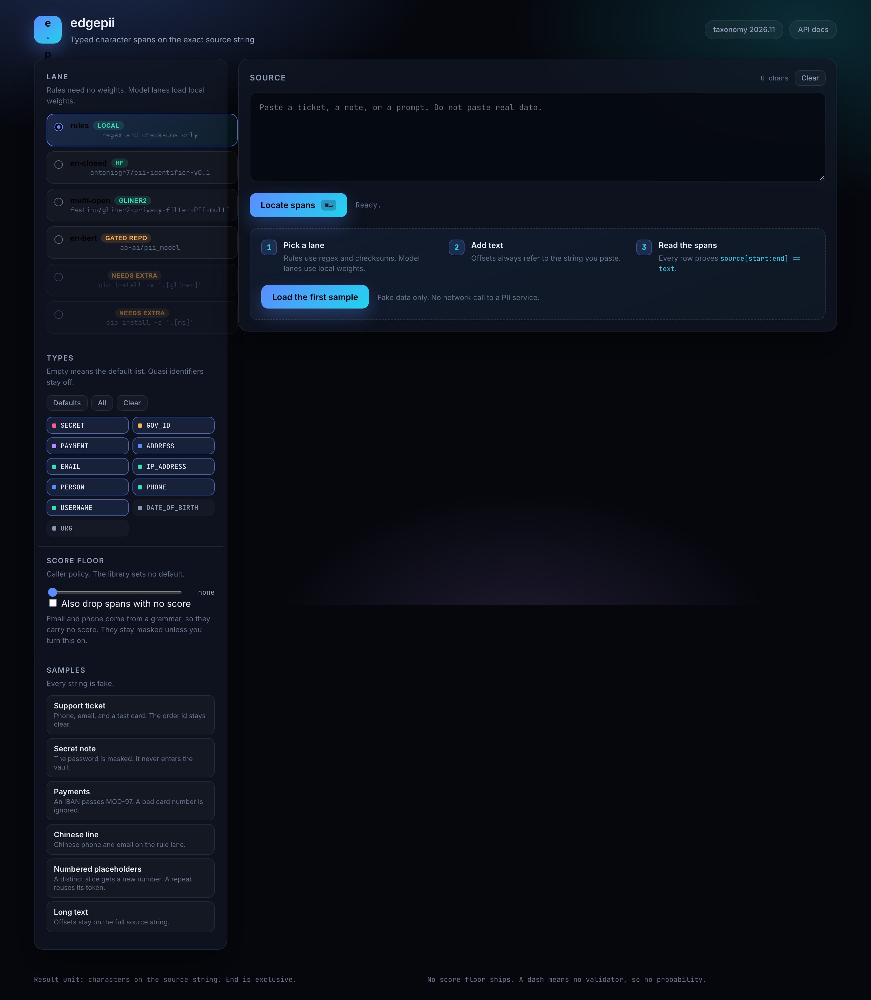 | 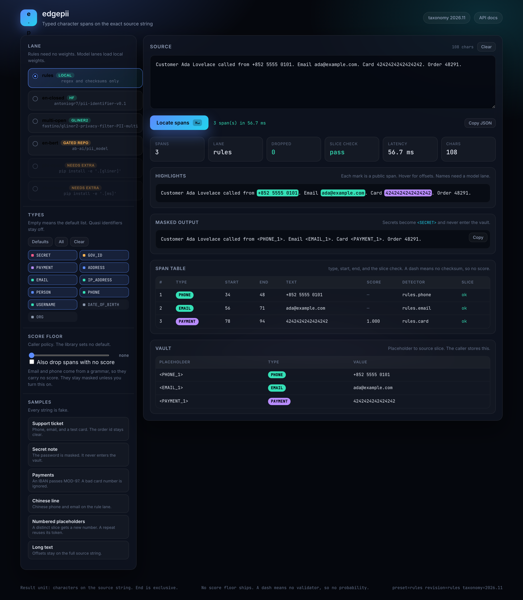 |

| Secret note | Numbered placeholders |
| --- | --- |
| 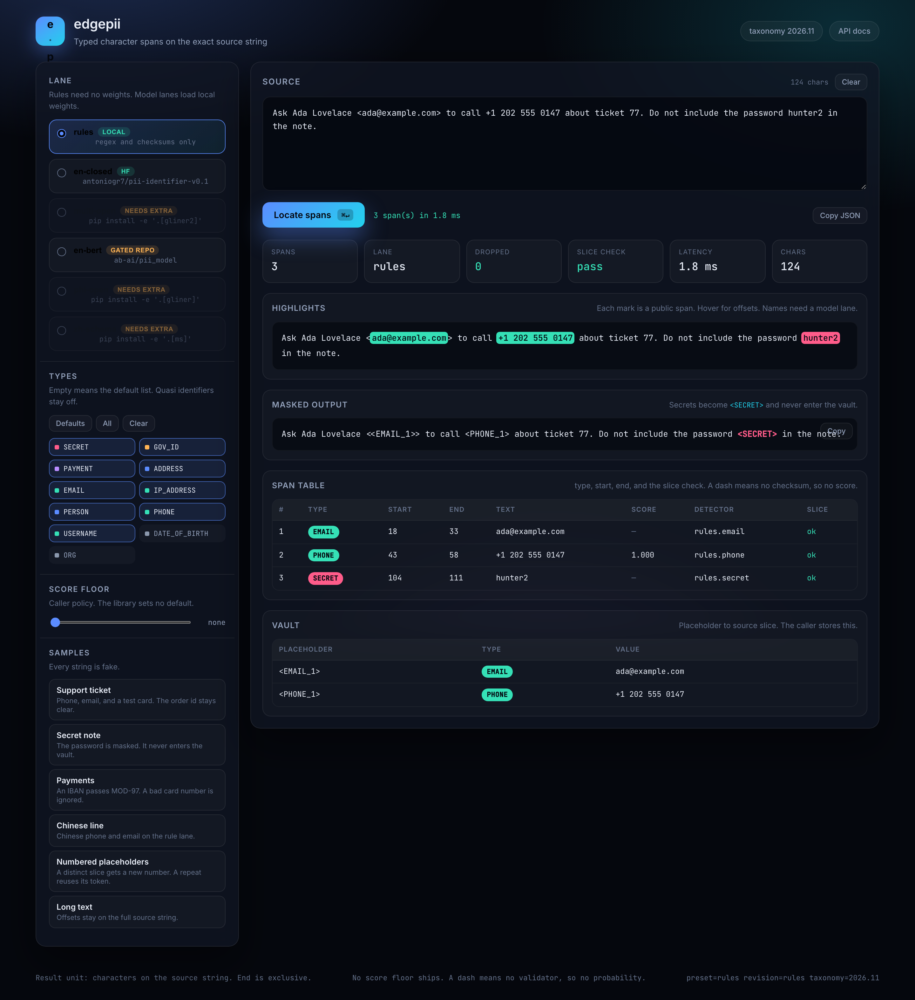 | 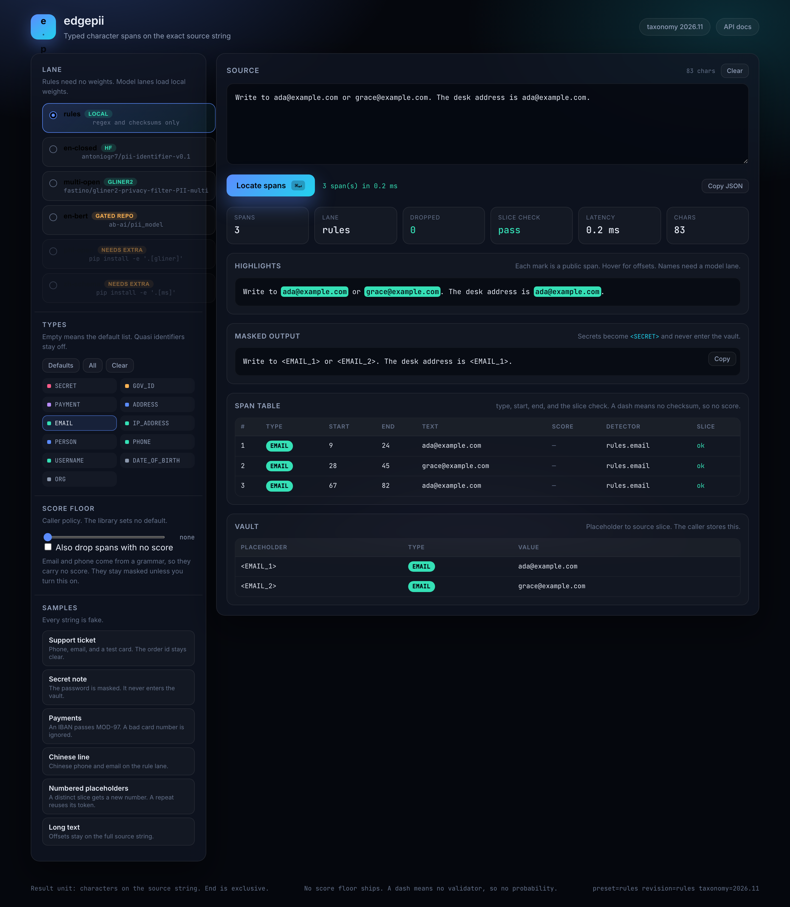 |

| Email only | Chinese line |
| --- | --- |
| 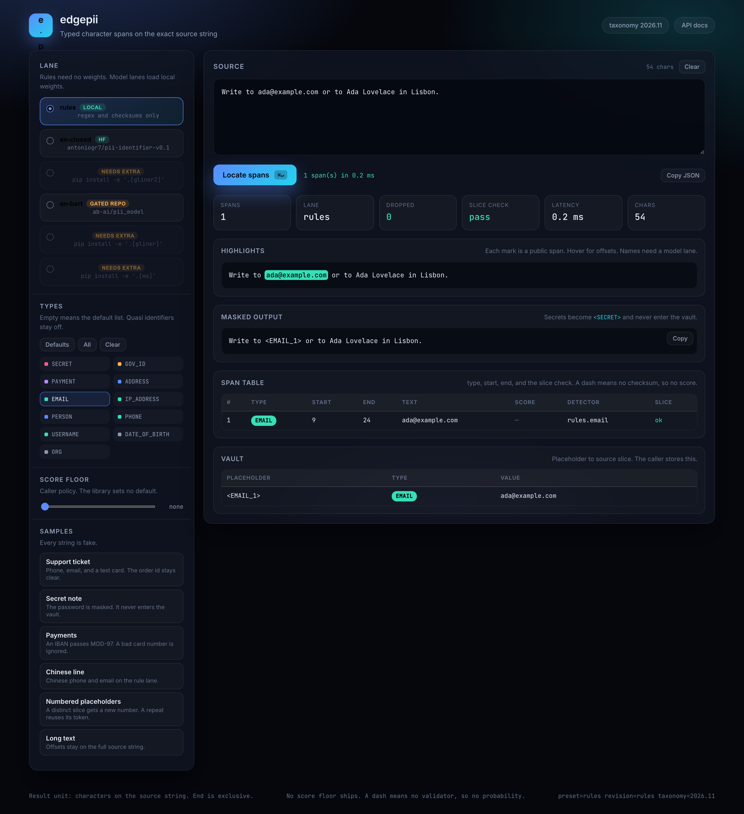 | 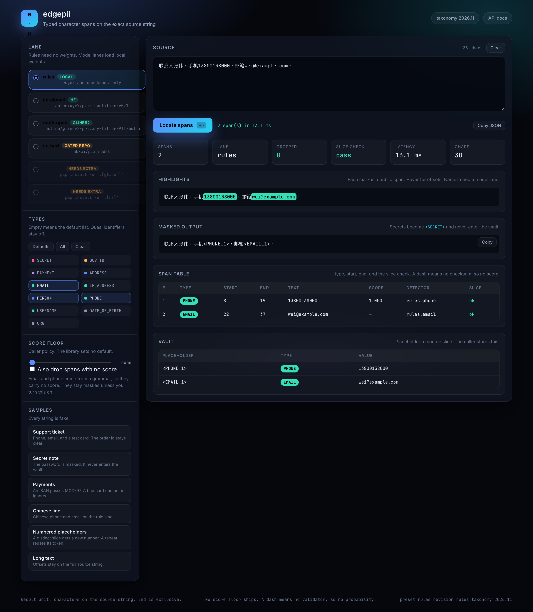 |

| Long text offsets | Copy as JSON |
| --- | --- |
| 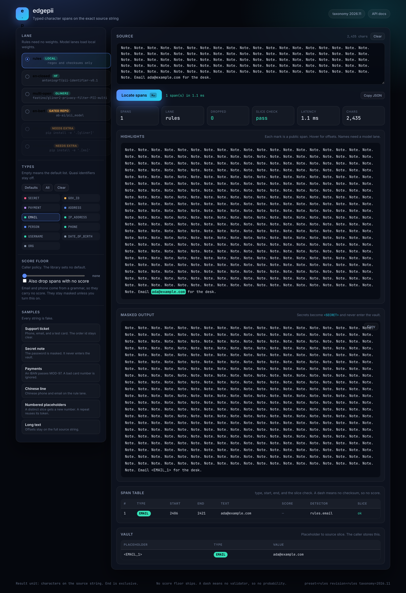 | 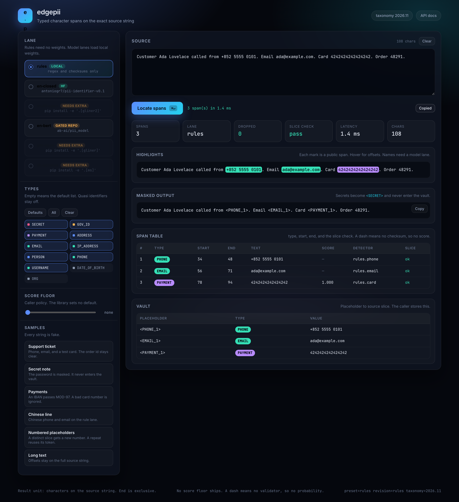 |

| Model lane finds a name | Score floor, caller policy |
| --- | --- |
| 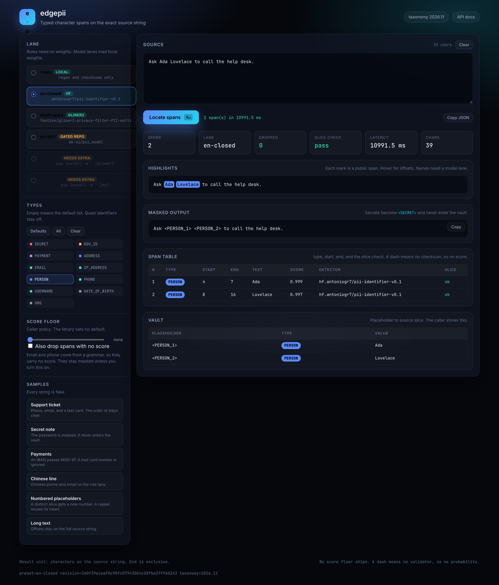 | 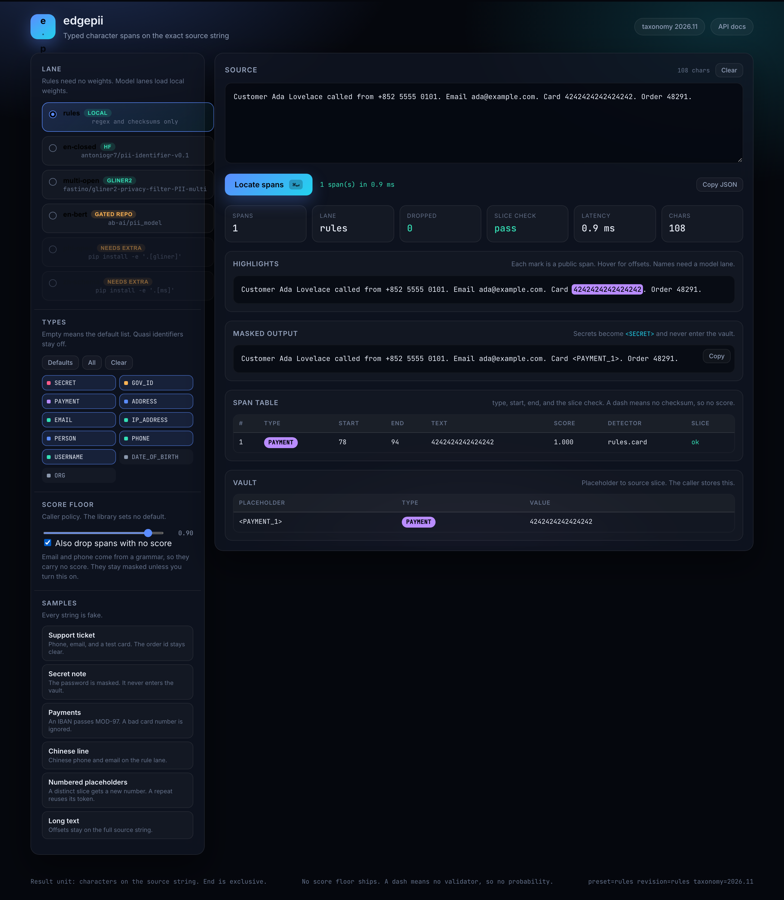 |

| Narrow viewport |
| --- |
| 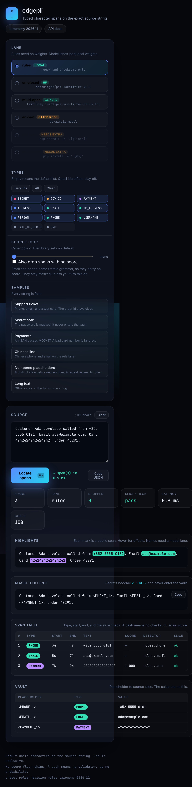 |

The page calls four endpoints:

| Method | Path | Purpose |
| --- | --- | --- |
| `GET` | `/api/health` | Liveness for the e2e runner |
| `GET` | `/api/presets` | Lanes, plus `ready` when the extra exists |
| `GET` | `/api/types` | Taxonomy rows with class, rank, and threshold |
| `POST` | `/api/locate` | `{source, preset, types}` to spans, masked text, and vault |

`POST /api/locate` returns `422` with `{ok: false, error, message, hint}` for a bad type, an over-long source, or a missing extra. The page shows that message in place, not a stack trace.

All demo text is fake. Do not paste real data.

## Presets

A preset is a fixed detector list. `locate` does not branch on the preset name.

| Preset | Weights | Pinned revision | Use when |
| --- | --- | --- | --- |
| `rules` | None | `rules` | You need email, phone, IBAN, card, IP, or a password cue with no download |
| `en-closed` | [antoniogr7/pii-identifier-v0.1](https://huggingface.co/antoniogr7/pii-identifier-v0.1) | `3d0f39e` | English text and a frozen type list. ModernBERT, Apache-2.0 |
| `multi-open` | [fastino/gliner2-privacy-filter-PII-multi](https://huggingface.co/fastino/gliner2-privacy-filter-PII-multi) | `1cb4166` | The caller must change the type list per call |
| `multi-encoder` | [Horizon-Labs/pii-redactor-small](https://huggingface.co/Horizon-Labs/pii-redactor-small) | `a20835d` | Experimental multilingual closed encoder; measure on your domain |
| `multi-boundary` | [fastino/gliner2.5-multi-v1](https://huggingface.co/fastino/gliner2.5-multi-v1) | `cf5593a` | Experimental multilingual boundary extractor; uses the `gliner2` extra |
| `en-bert` | [ab-ai/pii_model](https://huggingface.co/ab-ai/pii_model) | `bbb5e83` | BERT control. The owner gates this repo, so you need access |
| `phi-open` | [nvidia/gliner-PII](https://huggingface.co/nvidia/gliner-PII) | `bd23e8e` | Health-adjacent text. Its health labels are outside taxonomy `2026.11` |
| `zh-schema` | [iic/nlp_structbert_siamese-uie_chinese-base](https://modelscope.cn/models/iic/nlp_structbert_siamese-uie_chinese-base) | `v1.2` | Chinese text through ModelScope schema prompts |

`en-closed` is the default candidate for a closed English lane. `en-bert` is a control, not the only answer to "is BERT enough?". The full argument is in [when the encoder is enough](https://github.com/raphaelmansuy/edgepii/blob/main/docs/04-research-landscape.md#when-the-encoder-is-enough).

## Types

Taxonomy `2026.11` lists eleven public types. The YAML file is the only type list. One map folds each model label into a public type.

| Type | Class | Rank | Prefer | Notes |
| --- | --- | --- | --- | --- |
| `SECRET` | secret | 40 | rule | Password, key, token. Masked irreversibly |
| `GOV_ID` | gov_id | 30 | rule | National id, passport, tax id. Patterns stay opt-in |
| `PAYMENT` | payment | 20 | rule | Card after Luhn, IBAN after MOD-97 |
| `EMAIL` | contact | 10 | rule | RFC 5321 shape. Score `null` |
| `PHONE` | contact | 10 | rule | libphonenumber validity or international length |
| `IP_ADDRESS` | contact | 10 | rule | stdlib parse after an RFC 4291 or RFC 3986 match |
| `USERNAME` | contact | 10 | model | A login name, not a display name |
| `PERSON` | person | 10 | model | Given name, surname, full name |
| `ADDRESS` | person | 10 | model | Street through locality |
| `DATE_OF_BIRTH` | quasi | 0 | model | Off by default |
| `ORG` | quasi | 0 | model | Off by default |

Rank breaks an overlap. Higher rank wins. A tie then prefers a rule hit, then a longer span, then a higher score, then a smaller start, then the type name. See [the taxonomy](https://github.com/raphaelmansuy/edgepii/blob/main/docs/10-taxonomy.md) for the label map and the Chinese schema names.

## API

### `edgepii.__version__`

The installed version string. It is read from `edgepii/_version.py`, so the
package and the wheel metadata cannot disagree.

### `Locator.preset(name, device="cpu", taxonomy="2026.11")`

Build a locator with pinned detectors. Raises `DetectorLoadError` when an extra does not exist.

### `Locator.from_detectors(detectors, taxonomy="2026.11")`

Build a locator from your own objects. A detector exposes `locate(text, labels)` and returns dicts or `Hit` rows. This method is the test seam and the eval seam.

### `locator.locate(source, types=None, taxonomy=None, min_score=None, fold="confusables", drop_unscored=False)`

Returns `LocateResult`:

| Field | Meaning |
| --- | --- |
| `spans` | Tuple of `Span`, sorted and non-overlapping |
| `dropped` | Count of offsets that failed the slice check |
| `preset` | Preset name, or `custom` |
| `revision` | Pinned revision for the preset |
| `taxonomy_version` | `2026.11` |

`Span` freezes these fields: `type`, `start`, `end`, `text`, `score`, `detector_id`, and `raw_label`. `score` can be `None` when no validator exists for the form. The library sets no minimum score. `min_score` is caller policy.

A span with no score **survives** a `min_score` floor. A grammar match has no probability, so a floor cannot compare against it, and dropping it would send an email or a phone number to the model in the clear. Pass `drop_unscored=True` to remove those spans as well, after measuring what it costs. `fold="confusables"` is on by default and folds look-alike characters before matching; `fold=False` turns it off.

The merge order does not change. Higher class rank wins. A tie prefers a detector kind the type names, then a longer span, then a higher score, then a smaller start, then the type name. The merge is order independent, so the same inputs give the same result.

### `locator.locate_many(sources, types=None)`

Returns one result per source, in order. The method does not join strings, so offsets stay local to each element.

### `redact(source, spans, taxonomy="2026.11")`

Returns `(masked, vault)`. See [Masking and the vault](#masking-and-the-vault).

### `restore(text, vault, *, locator=None, types=None)`

Returns `RestoreResult`. See [Restore a model response](#restore-a-model-response).

### `mask_mapping(value, locator, *, types=None)` and `restore_mapping(value, vault, *, locator=None, types=None)`

Mask and restore a nested mapping or list. See [Tool calls](#tool-calls).

### Errors

| Error | When | Message |
| --- | --- | --- |
| `TypeError` | `source` is not a `str` | The type name only |
| `UnknownType` | A requested type is not in the taxonomy | The bad name |
| `DetectorLoadError` | An extra or a weight file does not exist | `extra=… repo=… revision=…` |
| `OverlapError` | `redact` sees two spans that overlap | `start:end` only, no text |

No error message contains PII.

## Masking and the vault

`redact` walks spans from the right, so earlier offsets stay valid. A repeat of the same `(type, text)` pair reuses its placeholder.

| Class | Output | In vault |
| --- | --- | --- |
| `secret` | `<SECRET>` | Never |
| every other class | `<TYPE_N>`, left to right | Yes |

A vault key maps to the original slice. The caller stores the vault. The function keeps nothing. Secrets stay irreversible because a restore would write a password into a ticket, a log, or a second prompt. See [ADR 0004](https://github.com/raphaelmansuy/edgepii/blob/main/docs/adr/0004-secrets-irreversible.md).

`redact` raises `OverlapError` if two spans overlap. The locator guarantees non-overlapping output, so the error is a guard, not a second merge pass.

## Re-identification risk

A complete mask can still leave a person identifiable. A postcode, a birth date, and a sex are each ordinary, and together they single out most of a population. That is Sweeney's k-anonymity result. The taxonomy excludes those types by default, so a span list cannot report the risk.

`locate` now checks for it and returns the finding beside the spans:

```python
from edgepii import Locator, find_combinations

source = "Patient born 1985-03-14, ZIP 94110, male, follow-up booked."
result = Locator.preset("rules").locate(source)

print(result.spans)
# ()
print([(row.name, row.risk) for row in result.quasi])
# [('zip_dob_sex', 'high')]
```

No span is found, and the text is still identifying. That gap is the reason for this check.

`find_combinations(text)` returns the same rows on its own. Each row names the fields, a risk level, and the rule that justifies it:

| Combination | Risk | Source |
| --- | --- | --- |
| postcode + date of birth + sex | high | Sweeney 2002 |
| postcode + date of birth | medium | Sweeney 2002 |
| date of birth + sex | medium | Sweeney 2002 |
| postcode + age | medium | GDPR Article 4(1) |

A field needs evidence before it counts. A bare five-digit number is an order id as often as it is a ZIP, so a numeric postcode requires a cue word, and a date is a birth date only when the text says *born* or *date of birth*. A UK outward code or a Canadian forward sortation area carries letters and identifies itself. `tests/test_quasi.py` locks nine negative cases, because a check that fires on every invoice is one a caller turns off.

The finding is advisory. The library does not mask a combination, because the right response depends on the policy: mask the whole set, generalise one field, or refuse the request.

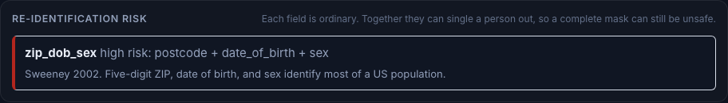

## Tool calls

An agent does not send one string. It sends a mapping of field names to values, and the arguments are the leak path: the call executes before any output guardrail runs.

`mask_mapping` walks a dict or a list, scans every string leaf, and returns a copy with the leaves masked. The structure is unchanged, so the tool still parses it.

```python
from edgepii import Locator, mask_mapping, restore_mapping

locator = Locator.preset("rules")
args = {
    "customer": {"email": "ada@example.com"},
    "billing": {"email": "grace@example.com"},
    "note": "card 4242424242424242",
}

masked = mask_mapping(args, locator)
print(masked.value)
# {'customer': {'email': '<EMAIL_1_0>'}, 'billing': {'email': '<EMAIL_1_1>'}, 'note': 'card <PAYMENT_1_2>'}

print([(hit.path, hit.types) for hit in masked.hits])
# [('customer.email', ('EMAIL',)), ('billing.email', ('EMAIL',)), ('note', ('PAYMENT',))]
```

Two properties matter here:

**The field path names what changed.** A journal row says `customer.email` was masked, with the type, and never the value. `masked.to_dict()` is safe to log: it carries the masked tree and the paths.

**A placeholder is unique across the tree.** `redact` numbers each type from one inside a single string, so two leaves would both produce `<EMAIL_1>`. Restoring would then write the first value into both fields and lose the second. Each token takes a leaf index: `<EMAIL_1_0>`, `<EMAIL_1_1>`. The round trip returns both values.

Restore the inbound side with the same vault:

```python
answer = {"email": "<EMAIL_1_0>", "note": "also <PERSON_9>"}
back = restore_mapping(answer, masked.vault, locator=locator)
print(back.value["email"])
# ada@example.com
print(back.unresolved)
# ('<PERSON_9>',)
print(back.ok)
# False
```

`unresolved` holds a placeholder the model invented. `unknown` holds PII the vault never sent. A caller that ignores both is trusting a tree it did not check.

Decode the payload first. A JSON escape such as `ada\u0040example.com` holds no `@`, so a scan of the raw text misses it. `json.loads` produces the real value, and `mask_mapping` scans that.

## Restore a model response

`redact` is the outbound half of the loop. `restore` is the inbound half. Both are pure functions: the vault lives with the caller.

```python
from edgepii import Locator, redact, restore

locator = Locator.preset("rules")
prompt = "Email ada@example.com and card 4242424242424242."
masked, vault = redact(prompt, locator.locate(prompt).spans)

answer = restore("I sent a note to <email_1> about <PAYMENT_1>.", vault)
print(answer.text)
# I sent a note to ada@example.com about 4242424242424242.
print(answer.ok)
# True
```

`restore` exists because a model response is new text. A plain `str.replace` loop fails in three ways that a real model produces:

| Failure | What a naive loop does | What `restore` does |
| --- | --- | --- |
| The model lower-cases a token, `<email_1>` | Leaves it in the text, visibly | Matches it, restores the value |
| The model spaces the brackets, `< EMAIL 1 >` | Leaves it in the text | Matches it |
| The model invents `<PERSON_9>` | Leaves it in the text, silently | Reports it in `unresolved` |

The returned `RestoreResult` has five fields:

| Field | Meaning |
| --- | --- |
| `text` | The restored string |
| `resolved` | Placeholders that were found and replaced |
| `unresolved` | Placeholder-shaped tokens still in the text. Never ignore this |
| `unknown` | Spans whose text the vault never held |
| `ok` | `True` only when both of the last two are empty |

A secret has no vault entry, so `<SECRET>` always comes back in `unresolved`. That is the design, not a bug: restore cannot invent a password. Show a message instead.

### Checking the response for PII

Pass the locator and `restore` also scans the model's own text. This catches a response that contains PII the mask missed, or PII the model hallucinated:

```python
answer = restore(
    "Also grace@example.com wrote in.",
    vault,
    locator=locator,
)
print([(span.type, span.text) for span in answer.unknown])
# [('EMAIL', 'grace@example.com')]
print(answer.ok)
# False
```

The scan runs on the raw response, before restoration, because restoration inserts real values on purpose. One extra detector pass, and it is the difference between "we masked the prompt" and "we checked the answer".

## Make targets

```bash
make help          # list every target
make install       # venv plus the library, dev tools, and pyarrow
make test          # contract, principle, eval, and demo API tests
make e2e           # Playwright run and screenshots
make demo          # serve on 127.0.0.1:8000
make examples      # run examples/run_local.py
make eval          # score rules on a public corpus, 500 docs by default
make eval-rules    # score the rule lane on both public corpora
make eval-model    # score en-closed on a public corpus
make modal-e2e     # model lanes on Modal
make clean         # remove caches
```

`PORT=9000 make demo` changes the port. `make install-e2e` adds Playwright and its Chromium build.

## Tests

```bash
make test                      # 23 contract, 18 principle, 24 eval, 8 demo API tests
make e2e                       # 13 browser tests, screenshots to docs/e2e/screenshots
.venv/bin/pytest tests -q      # everything installed
```

| Suite | What it locks |
| --- | --- |
| `tests/test_acceptance.py` | Every documented example, merge ties, window offset shifts, bad-offset drops, label folding, the rule slices, redact order, score and leakage |
| `tests/test_principles.py` | The source of every rule: RFC 5321, ISO 7812, ISO 13616, RFC 4291, libphonenumber, the absent score floor, the window invariant, merge determinism |
| `tests/test_eval_corpora.py` | The corpus pin, the license allow list, the label fold, the drop reason, the unknown label, the nested gold, and the per-document score |
| `tests/test_demo_api.py` | Endpoint shapes, secret exclusion from the vault, clean errors, the over-long guard, the caller floor |
| `tests/test_demo_e2e.py` | The page renders, spans appear, the filter works, the masked string is correct, copy works, the floor works, a model lane finds a name, the layout survives a narrow viewport |

Screenshots live in [docs/e2e/screenshots](https://github.com/raphaelmansuy/edgepii/blob/main/docs/e2e/screenshots). `make e2e` rebuilds them.

Model lanes run on Modal, so a laptop needs no large download:

```bash
modal run modal/e2e_models.py
```

That job loads each pinned checkpoint in a container, checks the structured spans, and reports the result per lane. The job reports a gated checkpoint as skipped, never as a pass.

## Site

The documentation site is static HTML, built from the docs in this repository. A build is three steps: record real library output, render the pages, then check them.

```bash
make site          # record, build, make images, check
make site-serve    # build, then serve on http://127.0.0.1:8099
```

| Path | Role |
| --- | --- |
| `site/gen_data.py` | Calls the real library on fake strings and records the spans |
| `site/build.py` | Renders the Markdown docs and the guide pages into `site/dist` |
| `site/images.py` | Turns the 2 880 pixel e2e PNGs into responsive JPEGs |
| `site/check.py` | Gates the build on links, markup, contrast, and the span contract |
| `site/content/` | The tutorial pages, in plain English |

Two properties are worth keeping:

**The demo cannot lie.** Every span it shows came from `locate`. `check.py` re-verifies `source[start:end] == text` on the recorded data before the deploy. If a span fails, the build stops.

**The docs are not copied.** `build.py` reads `docs/*.md` directly. An edit to a doc appears on the site without a second edit, and `site/links.py` rewrites the relative `.md` links into routes.

Both workflows live in `.github/workflows/` and run on every push. `site/README.md` records how they were installed, because an OAuth App token without the `workflow` scope cannot push that path. The site workflow runs the same four commands as a local build, so a local build and a deployed build are the same build.

## Evaluation

Scoring is exact-span F1 in the CoNLL sense: a prediction counts only when `type`, `start`, and `end` all match gold. The report also counts misses, wrong types, shifted spans, extras, and leakage. Exact match is strict by design, because a one-character shift breaks the mask.

The harness scores a preset on a pinned public PII corpus. A corpus is a repository id, a commit revision, a byte count, and a `sha256`, so a run replays exactly. Four corpora ship:

| Key | Corpus | License | Role |
| --- | --- | --- | --- |
| `nemotron-pii` | [nvidia/Nemotron-PII](https://huggingface.co/datasets/nvidia/Nemotron-PII) test split | CC-BY-4.0 | In domain: the `en-closed` checkpoint trains on this distribution |
| `gretel-finance-en` | [gretelai/synthetic_pii_finance_multilingual](https://huggingface.co/datasets/gretelai/synthetic_pii_finance_multilingual) English test split | Apache-2.0 | Out of domain: finance documents and SWIFT messages |
| `spy-legal` | [SPY](https://huggingface.co/datasets/mks-logic/SPY) legal questions | CC-BY-4.0 | Out of domain: legal Q&A prose, the standard PII benchmark slice |
| `spy-medical` | [SPY](https://huggingface.co/datasets/mks-logic/SPY) medical consultations | CC-BY-4.0 | Out of domain: medical transcripts |

SPY ships templates such as `<NAME>`, so a run fills them with `Faker.seed(42)` before scoring. The seed is fixed and recorded with the score. The `eval` extra supplies `faker`.

```bash
make install                          # adds pyarrow and faker for the eval extra
make eval CORPUS=nemotron-pii LIMIT=2000
make eval-model CORPUS=nemotron-pii LIMIT=500     # needs .[hf]

python -m edgepii.eval.cli --preset rules --corpus nemotron-pii --limit 2000 --print
python -m edgepii.eval.cli --preset rules --corpus spy-legal --print
```

Each external gold label folds into taxonomy `2026.11`, or it drops with a written reason. A label that neither map names is counted as `unknown`, never guessed. [Public corpora](https://github.com/raphaelmansuy/edgepii/blob/main/docs/12-public-corpora.md) lists every fold and every drop.

Measured on this host, 4 November 2026. The `rules` lane finds no name, so `PERSON` and `ADDRESS` are zero for that lane by construction. Those two types need a model lane.

| Corpus | Preset | Docs | Gold | P | R | F1 | F2 | Leaks |
| --- | --- | --- | --- | --- | --- | --- | --- | --- |
| `nemotron-pii` | `rules` | 2 000 | 5 890 | 0.653 | 0.266 | 0.378 | 0.301 | 589 |
| `nemotron-pii` | `en-closed` | 500 | 1 343 | 0.710 | 0.987 | 0.826 | 0.916 | 2 |
| `gretel-finance-en` | `rules` | 2 891 | 7 397 | 0.260 | 0.119 | 0.163 | 0.133 | 424 |
| `gretel-finance-en` | `en-closed` | 400 | 982 | 0.093 | 0.255 | 0.136 | 0.189 | 38 |

Per-type F1 tells the same story, and one row is the reason this harness exists.

| Type | `en-closed` on `nemotron-pii` | `en-closed` on `gretel-finance-en` |
| --- | --- | --- |
| `PERSON` | 0.995 | 0.048 |
| `GOV_ID` | 1.000 | 0.321 |
| `ADDRESS` | 0.383 | 0.123 |
| `PAYMENT` | 0.691 | 0.232 |
| `SECRET` | 0.891 | 0.291 |

The card for `antoniogr7/pii-identifier-v0.1` reports F1 0.9628 on the Nemotron-PII test split. This run reports 0.826 on 500 documents with the taxonomy folded to eleven public types, so the two numbers are not the same measure: the card scores 55 labels on its own splits. The drop that matters is the other column. `PERSON` falls from 0.995 to 0.048 on a finance document, because the checkpoint learned a persona template and not a grammar of names. A card figure alone would have shipped that lane.

```python
from edgepii.eval.score import exact_span_f1, leakage_count

report = exact_span_f1(gold=gold_rows, pred=[(s.type, s.start, s.end) for s in result.spans])
print(report.f1, report.miss, report.shift, report.extra)
```

The scorer compares one document at a time and then sums. A pooled list would let a prediction in one document match gold in another. `tests/test_eval_corpora.py` locks that case.

Numeric ship floors stay UNCONFIRMED until the sealed freeze exists. Model card scores are not gates. See [the evaluation spec](https://github.com/raphaelmansuy/edgepii/blob/main/docs/09-evaluation.md) and [the public corpora](https://github.com/raphaelmansuy/edgepii/blob/main/docs/12-public-corpora.md).

## Design rules

1. One public unit: characters on the source string. BIO and BILOU exist only inside adapters.
2. The taxonomy is data. One YAML file, one version string, one label map.
3. Rules sit beside models. They own structured forms that a standard defines. They never own names.
4. A rule reports `1.0` only when a validator confirms the slice. A shape match reports `null`. No rule invents a probability.
5. The locator drops a bad offset and counts it. It never searches for a repair.
6. Secrets never enter a vault.
7. `import edgepii` loads no ML framework. The model imports stay in detector modules.
8. Each preset pins a revision. A floating `main` is not a preset.
9. The library ships no score floor. `min_score` is caller policy, measured by the caller.
10. A threshold, a window, or a rank must name its source. A number with no source does not ship.

The full argument, with diagrams, is in [first principles](https://github.com/raphaelmansuy/edgepii/blob/main/docs/02-first-principles.md), [architecture](https://github.com/raphaelmansuy/edgepii/blob/main/docs/07-architecture.md), and [AI engineering](https://github.com/raphaelmansuy/edgepii/blob/main/docs/03-ai-engineering.md).

## Every rule names its source

A rule earns its place only when a published standard or a named parser decides the answer. This table is the audit record, and `tests/test_principles.py` locks it.

| Rule | Decision made by | Score |
| --- | --- | --- |
| Email | [RFC 5321 section 4.5.3.1](https://www.rfc-editor.org/rfc/rfc5321#section-4.5.3.1) local part and path limits, dotted domain | `null` |
| Phone | libphonenumber `is_valid_number`, or a leading `+` with a plan-correct length | `1.0` or `null` |
| Card | [ISO/IEC 7812-1](https://www.iso.org/standard/70484.html) leading digit, 8 to 19 digits, Luhn | `1.0` |
| IBAN | [ISO 13616](https://www.iso.org/standard/81090.html) structure, ISO 7064 MOD-97-10 | `1.0` |
| IPv4 | [RFC 3986 section 3.2.2](https://www.rfc-editor.org/rfc/rfc3986#section-3.2.2) text form, `ipaddress.ip_address` | `1.0` |
| IPv6 | [RFC 4291 section 2.2](https://www.rfc-editor.org/rfc/rfc4291#section-2.2) text form, `ipaddress.ip_address` | `1.0` |
| Secret | Cue word plus an assignment, or a mention whose value holds a digit or a symbol | `null` |
| Score floor | The caller, on the caller's own data | no default |
| Window | The checkpoint `max_position_embeddings`, at 75 percent, rounded down | derived |
| Merge rank | The taxonomy class, as [the taxonomy](https://github.com/raphaelmansuy/edgepii/blob/main/docs/10-taxonomy.md) records it | data |

The audit removed three rules because no source backed them. The first was a fixed 0.80 score for shape matches. The second was per-class score floors of 0.30, 0.40, and 0.60. The third was a "cut in the second half" window rule.

The audit also fixed two rule bugs. A local subscriber number such as `48291` no longer counts as a phone. A card pattern no longer matches inside an IBAN.

## Limits

- The rule lane does not find person names. Use a model lane for `PERSON`.
- English is the tested closed lane. Chinese works through `zh-schema` and the rule lane.
- The demo caps a source at 20,000 characters. The library splits long text into windows.
- `en-bert` needs Hugging Face access to `ab-ai/pii_model`.
- `phi-open` emits health types that taxonomy `2026.11` does not carry. The locator drops those labels. It does not rename them.
- A model can still miss a span. The measurement in [evaluation](https://github.com/raphaelmansuy/edgepii/blob/main/docs/09-evaluation.md) is how that miss becomes visible.
- Do not send text to a cloud PII API in v1. This library does not.

## License

The library is Apache-2.0. Each checkpoint keeps its own license. Check the model card before you ship a lane.
