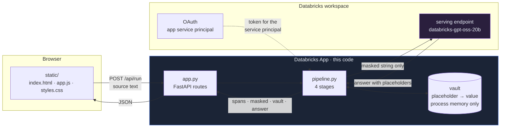
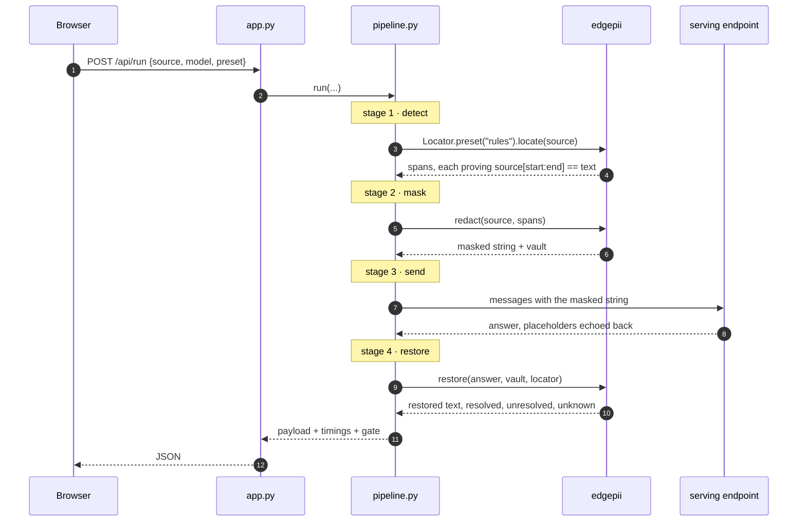
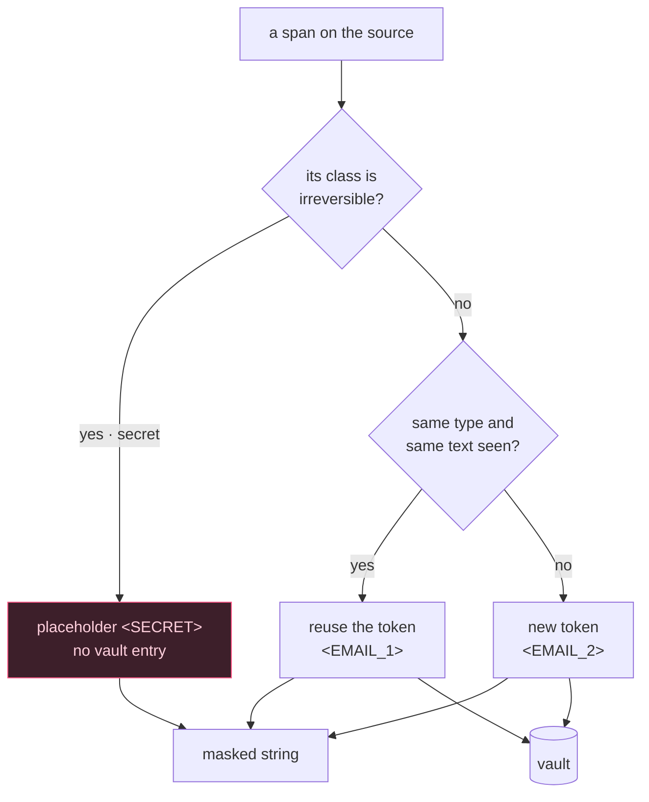
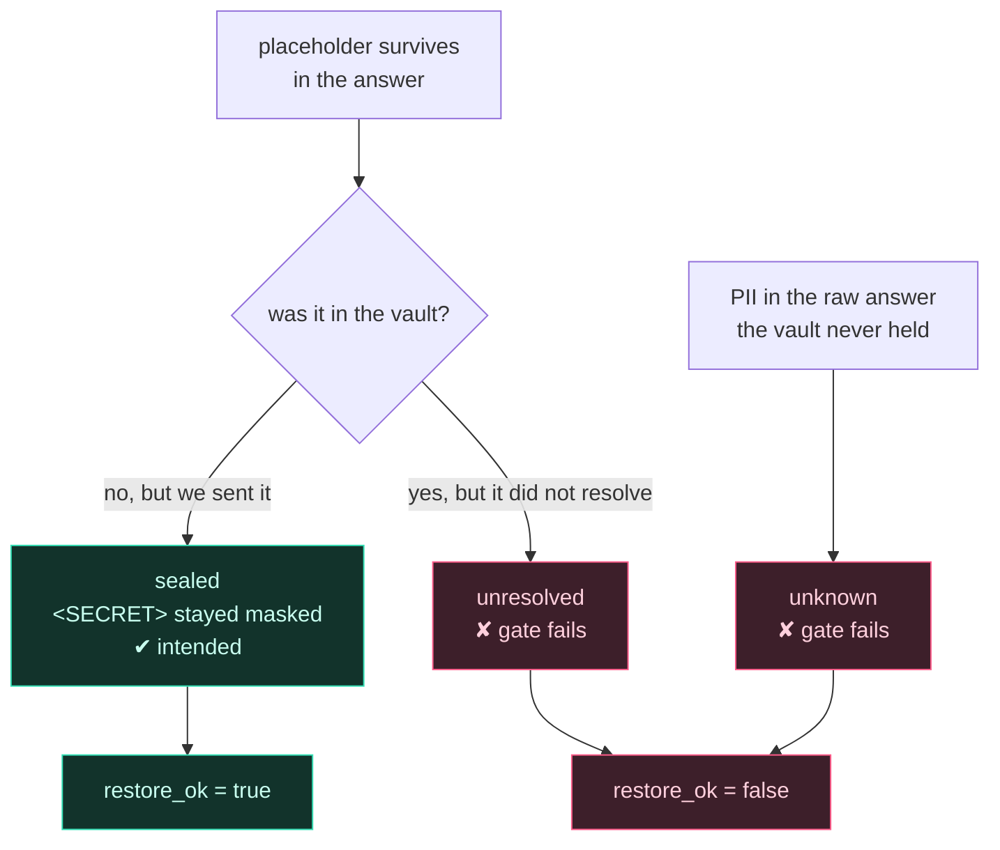
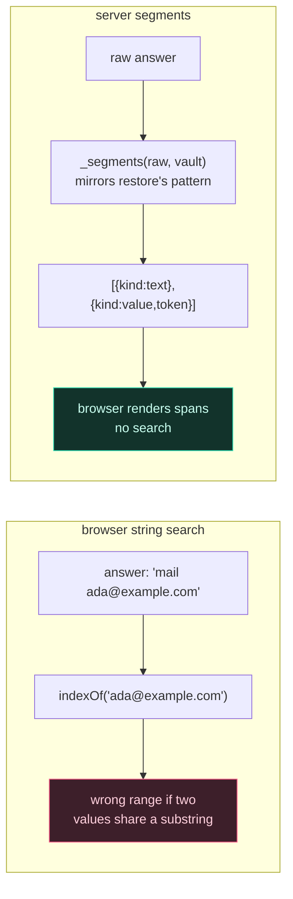
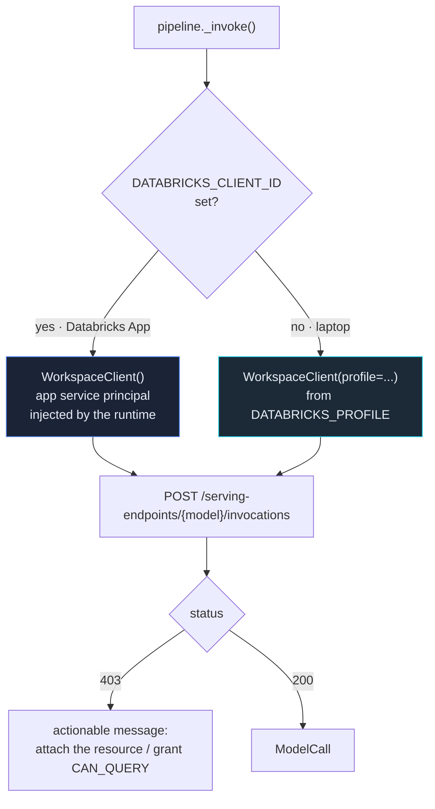

# Architecture

<!-- ste: descriptive -->

This file explains how the Databricks App demo is built and why each part sits
where it does. The [README](README.md) covers deploy steps and endpoints. The
library's own module map is in [docs/07-architecture.md](../../docs/07-architecture.md).

The app is a thin shell around one promise: **the values in a ticket never reach
the model, and they come back in the answer.**

## 1. Context

Who talks to whom, and what crosses each boundary.

The dashed edge is the reason the browser holds no credential. The app
authenticates as its own service principal, and that identity is what the
endpoint sees.

## 2. The four stages

One request, four stages, in the order that makes the boundary provable.

Stage 3 is the only stage that leaves the process. Everything the model can see
is the string `masked`, and stage 2 built it from spans that stage 1 proved.

## 3. Inside stage 2: what the vault holds

The vault is an ordinary dict, and the taxonomy decides what enters it.

Two consequences the demo makes visible:

- A repeated value gets the **same** token, so the model sees one person rather
  than two. The *Repeat values* sample shows this.
- A secret is **sealed**, never vaulted. It cannot be restored, by design. See
  [ADR 0004](../../docs/adr/0004-secrets-irreversible.md).

## 4. The gate

`restore` reports three kinds of leftover, and the app treats them differently.
This is the part that is easy to get wrong.

`outcome.ok` from the library calls `<SECRET>` a failure, because the library
cannot know the caller intended it. The pipeline narrows that: it computes
`sealed` as the tokens it sent that were never in the vault, and fails only on
`unresolved` or `unknown`. Without this, the credential sample reported a false
failure while behaving exactly right.

## 5. Why the server picks the highlighted ranges

The UI marks restored values in the answer. The obvious approach — search the
answer for each vault value — breaks.

`_segments` runs the same pattern `restore` uses, longest token first, and
records which token produced which range. A test asserts the segments
concatenate to exactly `restore`'s text, so the highlight cannot drift from the
answer.

## 6. Module map

| Module | Owns | Does not own |
| --- | --- | --- |
| `app.py` | Routes, request model, samples, static mount | Detection, masking, model calls |
| `pipeline.py` | The four stages, the gate, timing, segments | HTTP routing, HTML |
| `static/app.js` | Rendering, pickers, copy | Any decision about what is PII |
| `static/index.html` | Structure | Content |
| `static/styles.css` | One dark surface, per-class colours | Behaviour |
| `app.yaml` | Start command, `EDGEPII_MODELS` | Code |
| `requirements.txt` | Pinned `edgepii`, FastAPI, uvicorn, SDK | Source |

`pipeline.py` imports no FastAPI, so `tests/test_app_pipeline.py` exercises all
four stages with the model call stubbed. The suite needs no network and no
serving endpoint.

## 7. Two runtimes, one code path

The same `pipeline.py` serves a laptop and the app. Only credential discovery
differs.

This is why the app needs no secret resource. In the app, the runtime provides
the identity. On a laptop, the CLI's cached token does.

A 403 gets its own message because it is the one failure a reader is most likely
to hit, and the generic HTTP error does not say which of the two fixes applies.

## 8. What the app does not do

The demo is honest about its edges, and three of them matter.

| Not done | Why | Where it shows |
| --- | --- | --- |
| Model lanes | They pull torch and a checkpoint at first request, turning a one-minute start into an unbounded download | The sidebar offers `rules` only |
| Person names on the rule lane | `rules` is regex and checksums. A name needs a model | The **The name gap** sample |
| Server-side vault | The demo returns the vault so a reader can see which values came back | `POST /api/run` response |

A production caller keeps the vault server-side and returns only `answer`. That
is a one-line change in `pipeline.run`, and the README says so.

## 9. Local and Databricks side by side

| Concern | Local | Databricks App |
| --- | --- | --- |
| Start | `make app` | `databricks apps deploy` |
| Port | 8000 (override with `PORT`) | 8000, from `app.yaml` |
| Identity | `DATABRICKS_PROFILE` | injected service principal |
| Endpoint grant | the profile needs `CAN_QUERY` | the app resource grants it |
| Source | working tree, `--reload` | a Git commit, resolved and pinned |
| Vault | process memory | process memory |
| Failure to expect | `auth` with a login hint | `forbidden` with a resource hint |

The differences are all in credential discovery and file delivery. The four
stages, the gate, and the payload are identical, which is why the same tests
cover both.
