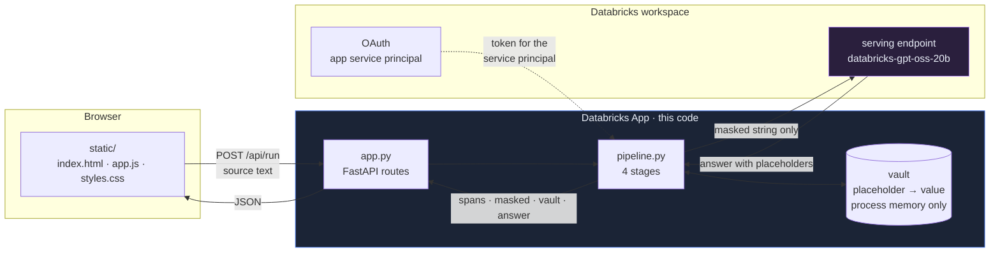
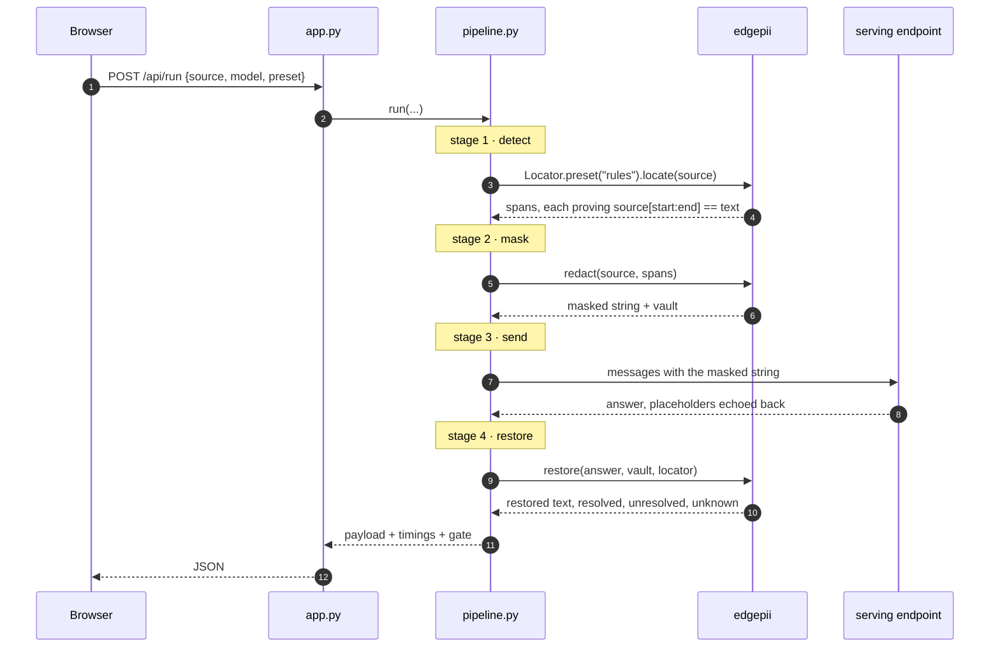
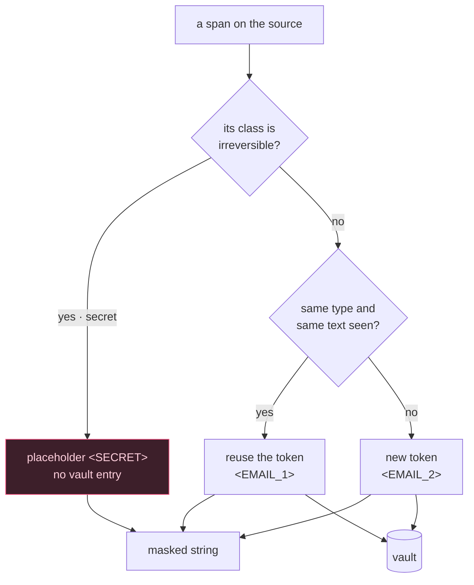
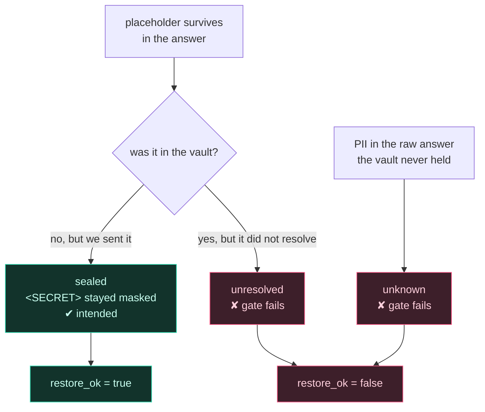
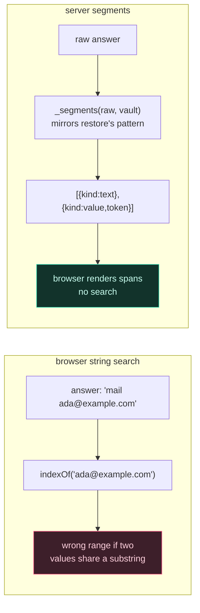
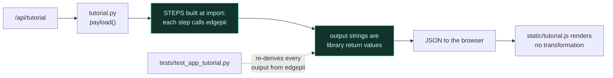
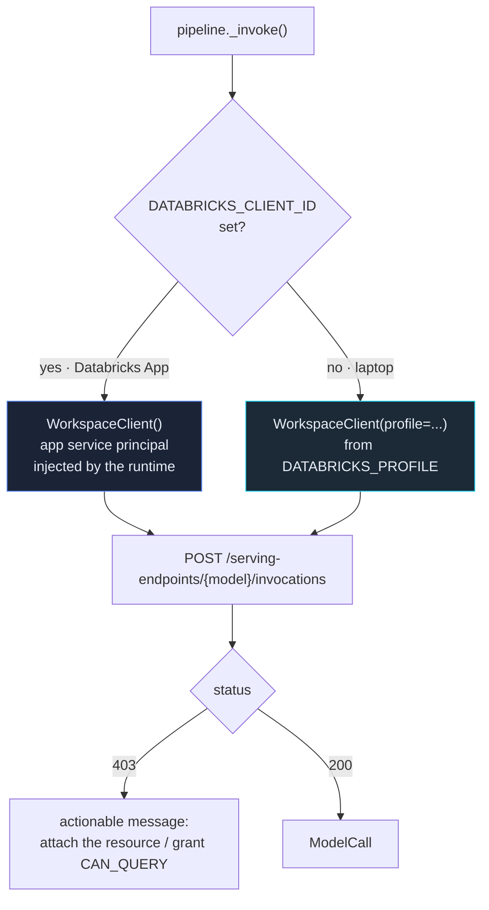
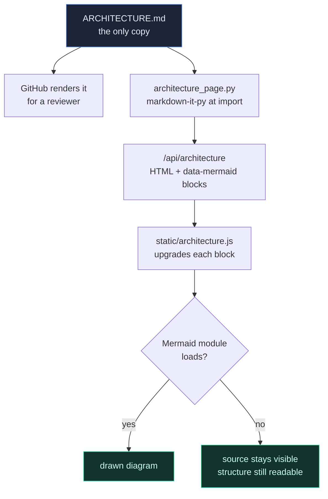
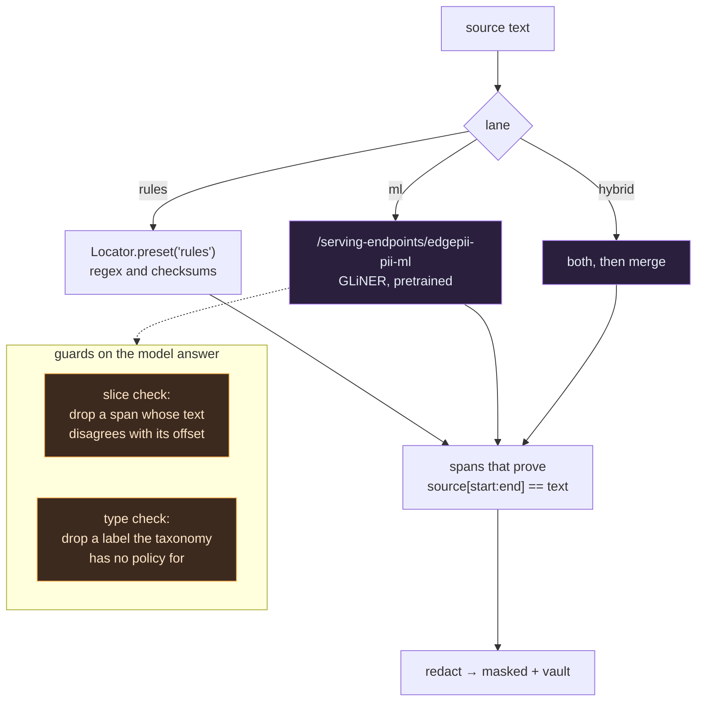
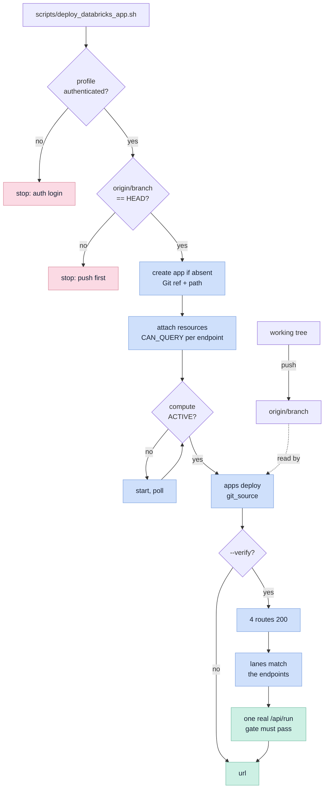

# Architecture

<!-- ste: descriptive -->

This file explains how the Databricks App demo is built and why each part sits
where it does. The [README](README.md) covers deploy steps and endpoints. The
library's own module map is in [docs/07-architecture.md](../../docs/07-architecture.md).

The app is a thin shell around one promise: **the values in a ticket never reach
the model, and they come back in the answer.**

## 1. Context

Who talks to whom, and what crosses each boundary.

The dashed edge is the reason the browser holds no credential. The app
authenticates as its own service principal, and that identity is what the
endpoint sees.

## 2. The four stages

One request, four stages, in the order that makes the boundary provable.

Stage 3 is the only stage that leaves the process. Everything the model can see
is the string `masked`, and stage 2 built it from spans that stage 1 proved.

## 3. Inside stage 2: what the vault holds

The vault is an ordinary dict, and the taxonomy decides what enters it.

Two consequences the demo makes visible:

- A repeated value gets the **same** token, so the model sees one person rather
  than two. The *Repeat values* sample shows this.
- A secret is **sealed**, never vaulted. It cannot be restored, by design. See
  [ADR 0004](../../docs/adr/0004-secrets-irreversible.md).

## 4. The gate

`restore` reports three kinds of leftover, and the app treats them differently.
This is the part that is easy to get wrong.

`outcome.ok` from the library calls `<SECRET>` a failure, because the library
cannot know the caller intended it. The pipeline narrows that: it computes
`sealed` as the tokens it sent that were never in the vault, and fails only on
`unresolved` or `unknown`. Without this, the credential sample reported a false
failure while behaving exactly right.

## 5. Why the server picks the highlighted ranges
The UI marks restored values in the answer. The obvious approach — search the
answer for each vault value — breaks.

`_segments` runs the same pattern `restore` uses, longest token first, and
records which token produced which range. A test asserts the segments
concatenate to exactly `restore`'s text, so the highlight cannot drift from the
answer.

## 6. Module map

| Module | Owns | Does not own |
| --- | --- | --- |
| `app.py` | Routes, request model, samples, static mount | Detection, masking, model calls |
| `pipeline.py` | The four stages, the gate, timing, segments | HTTP routing, HTML |
| `tutorial.py` | The six tutorial steps, with output from the library | HTTP routing, rendering |
| `architecture_page.py` | Rendering `ARCHITECTURE.md` to HTML | Any second copy of the architecture |
| `static/app.js` | Demo rendering, pickers, copy | Any decision about what is PII |
| `static/tutorial.js` | Tutorial rendering | The examples, which come from `tutorial.py` |
| `static/architecture.js` | Diagram upgrade, source toggle, copy | The document, which comes from `ARCHITECTURE.md` |
| `static/index.html` | Demo structure | Content |
| `static/tutorial.html` | Tutorial structure | Content |
| `static/architecture.html` | Architecture structure | The architecture content |
| `static/styles.css` | One dark surface, per-class colours | Behaviour |
| `app.yaml` | Start command, `EDGEPII_MODELS` | Code |
| `requirements.txt` | Pinned `edgepii`, FastAPI, uvicorn, SDK | Source |

`pipeline.py`, `tutorial.py`, and `architecture_page.py` import no FastAPI, so
`tests/test_app_pipeline.py`, `tests/test_app_tutorial.py`, and
`tests/test_app_architecture.py` exercise all three with no network and no
serving endpoint.

### 6.1 Why the tutorial generates its own examples

The tutorial is the one page where a stale string is actively harmful: a reader
copies the code, runs it, and gets different output than the page promised. So
no output on that page is typed by hand.

Three properties follow:

- **Offline.** The rule lane needs no weights, so the page builds in
  milliseconds with no credentials. A reader with no Databricks profile still
  gets all six steps.
- **Honest about the one network step.** Step 5 restores a *fixed* model answer
  rather than inventing one, and the page says so. The live endpoint is what the
  demo page is for.
- **Locked by tests.** Each assertion re-derives the value from the library and
  compares it to the page. If a library change alters `redact`, the tutorial test
  fails before the page can go stale.

One step had to be rewritten because of this. Step 3 originally printed
`'hunter2' in the vault: False` to prove the secret was gone, which put the
password on a page explaining that passwords must not be printed. It now prints
two booleans computed against the vault, and a test asserts the secret string is
absent from the output.

## 7. Two runtimes, one code path

The same `pipeline.py` serves a laptop and the app. Only credential discovery
differs.

This is why the app needs no secret resource. In the app, the runtime provides
the identity. On a laptop, the CLI's cached token does.

A 403 gets its own message because it is the one failure a reader is most likely
to hit, and the generic HTTP error does not say which of the two fixes applies.

## 8. What the app does not do

The demo is honest about its edges, and three of them matter.

| Not done | Why | Where it shows |
| --- | --- | --- |
| Model lanes | They pull torch and a checkpoint at first request, turning a one-minute start into an unbounded download | The sidebar offers `rules` only |
| Person names on the rule lane | `rules` is regex and checksums. A name needs a model | The **The name gap** sample |
| Server-side vault | The demo returns the vault so a reader can see which values came back | `POST /api/run` response |

A production caller keeps the vault server-side and returns only `answer`. That
is a one-line change in `pipeline.run`, and the README says so.

## 9. Local and Databricks side by side

| Concern | Local | Databricks App |
| --- | --- | --- |
| Start | `make app` | `databricks apps deploy` |
| Port | 8000 (override with `PORT`) | 8000, from `app.yaml` |
| Identity | `DATABRICKS_PROFILE` | injected service principal |
| Endpoint grant | the profile needs `CAN_QUERY` | the app resource grants it |
| Source | working tree, `--reload` | a Git commit, resolved and pinned |
| Vault | process memory | process memory |
| Failure to expect | `auth` with a login hint | `forbidden` with a resource hint |

The differences are all in credential discovery and file delivery. The four
stages, the gate, and the payload are identical, which is why the same tests
cover both.

## 10. One Markdown file, three readers
`ARCHITECTURE.md` is read three ways, and none of them restates its content.

Two decisions follow from this:

- **The page renders the file, not a copy of it.** A page that restated the
  architecture in its own words would drift from the file the moment either
  changed. `architecture_page.rendered()` reads the deployment's own
  `ARCHITECTURE.md`, so the page cannot disagree with the file.
- **A diagram is an enhancement, not a requirement.** Mermaid loads from a CDN,
  which may be blocked. The source stays on the page underneath, and the page
  says how many diagrams drew. A reader with no CDN access still sees every
  diagram's structure, which is the same rule the repo's docs site follows.

The escaping is the one subtle part. `markdown_it` escapes the fence body, so the
HTML must unescape it before handing the text to Mermaid, or Mermaid receives
`&amp;lt;` and draws it literally. A test asserts each diagram block's text is
byte-identical to the fence in the Markdown file.

## 11. The ML lane

The demo has three detection lanes. They exist because the rule lane has a
documented blind spot: it cannot see a person name.

| Lane | Where it runs | What it costs | Finds a name |
| --- | --- | --- | --- |
| `rules` | in the app process | microseconds | no |
| `ml` | a serving endpoint | one network call | yes |
| `hybrid` | both, merged | one network call | yes, plus proven rule types |

### Why a pretrained model, not one trained here

The first attempt trained a character n-gram classifier on the pinned
Nemotron-PII corpus. It reached 0.763 macro F1 and could not see a name built
from parts it had not memorised. The repo already measured the pretrained
alternative: `multi-open`, the GLiNER lane, scored **0.821 exact recall** with
**zero high-severity misses** on the finance slice. Pretrained won on quality,
on effort, and because its errors were already measured rather than newly
produced.

`ml/train_pii_classifier.py` stays in the tree. It is the comparison, and it is
reproducible in under a minute. It is not the lane that ships.

### Why the model is remote

The two earlier model lanes, `en-closed` and `multi-open`, load torch inside the
app process. That turns a one-minute app start into an unbounded checkpoint
download, which is why neither was ever offered in the deployed demo. Serving the
model moves that cost to the endpoint, where it is paid once at deploy time and
then kept warm or scaled to zero.

### The two guards

A remote model is exactly where an unchecked offset would come from, so neither
guard is optional:

1. **Slice check.** `source[start:end]` must equal the span's own text. A span
   that fails is dropped, never repaired. Repair would invent a claim the model
   never made.
2. **Type check.** The label must exist in taxonomy `2026.11`. Without this, an
   unknown label would reach `taxonomy.types[...]` and raise there, far from the
   model that caused it.

Both have tests, and one of them pins the exact two-level JSON envelope the live
endpoint returns, so a future MLflow change fails in the suite rather than in the
deployment.

### What the lane cannot do

The endpoint handles 8,000 characters per call and the app refuses longer input
with a message rather than truncating it. Truncation would silently drop spans,
which is worse than refusing.

### An observed false positive

Honest documentation means naming the errors this lane makes. On the sample

> `Ada Lovelace opened ticket 48291 from +852 5555 0101 …`

the served model labels the ticket number `48291` as `GOV_ID` with score 0.922,
so the masked string becomes `<PERSON_1> opened ticket <GOV_ID_1> …`. That is a
false positive: an order id is not a government id.

Three things follow from it, and none of them is "raise the threshold".

- **A false positive over-masks, which is the safe direction.** The alternative
  error leaves a value in the clear. The demo shows the mask widening rather than
  hiding it.
- **The rule lane would not make this mistake.** It requires an SSN shape and a
  cue. This is the trade the `hybrid` lane cannot resolve by itself: a model can
  over-label what a grammar would reject.
- **`GOV_ID` is `prefer: rule` in the taxonomy.** Merge does not drop the model
  span, because the rule lane found nothing to displace it. Preference decides
  between two spans on the same characters, not whether one exists.

A caller who needs to suppress this has three options, in increasing cost: raise
`EDGEPII_ML_THRESHOLD`, narrow the label list in `ml/serve_gliner.py`, or add a
policy gate that drops a span whose type has no structural validator. The demo
does none of them, because hiding the error would defeat the point of showing a
classifier's real output.

## 12. Deployment

The deploy has one constraint that shapes everything else: **this workspace only
deploys an app from a Git ref.** There is no upload path. A deploy reads the
remote commit, so an unpushed change is not deployed and no error says so.

### The five failures worth knowing

Each of these was hit while building the demo, and each produces a message that
does not name its cause on its own.

| Symptom | Cause | Fix |
| --- | --- | --- |
| `Git repository is required` | The workspace refuses app creation without one | Pass `git_repository` in the create payload |
| `No command to run` | The app directory is not at the deployed ref | Push, then redeploy; the path is read from the remote |
| `not in RUNNING state` | `apps deploy` needs compute `ACTIVE` | `apps start`, then poll until `ACTIVE` |
| `403` from a run | The service principal lacks `CAN_QUERY` | Attach the endpoint as a resource |
| Deploy `SUCCEEDED`, app broken | Success means the deployment applied, not that the app answers | Run `--verify` |

### Why verification is a separate step

`apps deploy` returns `SUCCEEDED` once the deployment record is written. The app
may still be failing to import, missing an environment variable, or unable to
reach an endpoint. The script therefore makes one real call and asserts the gate
passed, because that is the only check that exercises the whole path: credential
discovery, both endpoints, and the four stages.

### Environment the app reads

| Variable | Effect when unset |
| --- | --- |
| `EDGEPII_MODELS` | Falls back to `databricks-gpt-oss-20b` |
| `EDGEPII_ML_ENDPOINT` | The ML lane disappears; only `rules` is offered |
| `EDGEPII_ML_THRESHOLD` | `0.4` |
| `EDGEPII_ML_WITH_RULES` | `1`, so `hybrid` is offered |

The app starts and serves all three pages with every one of these unset. Only
`/api/run` needs credentials and endpoints, which is what makes the demo readable
before it is deployable.
