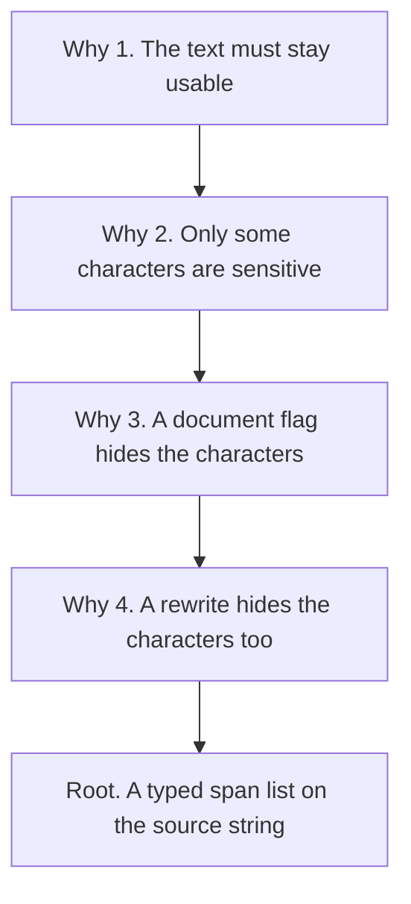
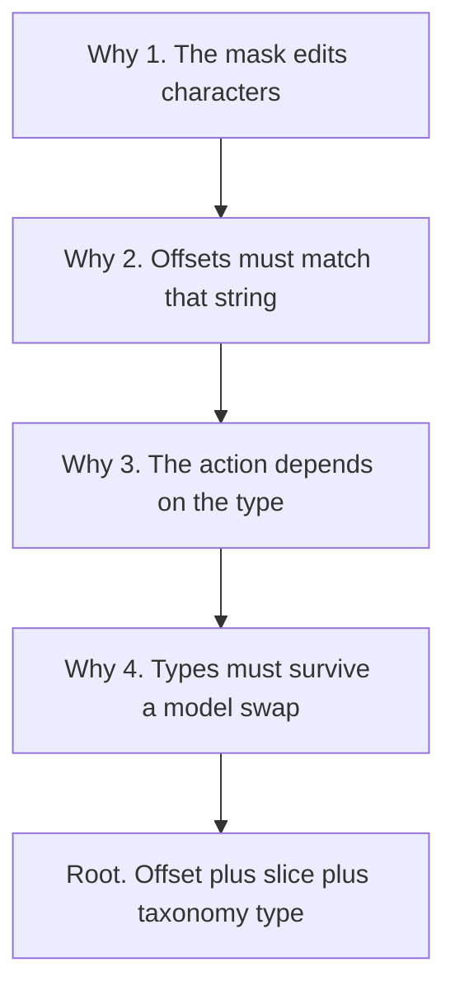

# Five whys

<!-- ste: descriptive -->

Read this file first. The later specs only add a contract, a model, or a module when a why in this file requires it.

Two chains are enough. Chain A asks why a library must exist. Chain B asks why the result must be a typed character span. Each answer is the input to the next why. The root is the last line of each chain.

Source notes: [Locate PII spans](https://app.notion.com/p/40c887c3416481c79345da8888298a75) and [Hide names and phones](https://app.notion.com/p/407887c3416481daa9a7e3ce8b346775).

## Chain A. Why locate PII at all?

### Why 1. Why do teams need to find PII in text?

Teams already send tickets, notes, and prompts to other systems. Some of those strings name a person, a phone, or an account. The team still needs the rest of the string to do the work. A refund note is useless if the only safe act is to delete the file.

The work needs the text. The person needs the sensitive parts controlled. Location is the split between those two needs.

### Why 2. Why control parts of the string instead of blocking the whole string?

A whole-string block is safe and idle. The ticket never gets an answer. A whole-string allow is useful and unsafe. The remote model, the log, or the vendor keeps a copy. A copy cannot be unsent.

Carlini and others showed that models can emit training strings they memorized ([arXiv:2012.07805](https://arxiv.org/abs/2012.07805)). Prompt injection can push a model to reveal user data ([arXiv:2406.00199](https://arxiv.org/abs/2406.00199)).

The useful act is smaller than the file. Mask, drop, or hold only the sensitive characters. Leave the order id, the question, and the instruction in place when policy says they are not personal.

### Why 3. Why is a flag on the document not that act?

A flag says "this document has PII" or "it does not". The flag does not say which characters to mask. An auditor cannot replay the flag and check the mask. A redaction tool cannot apply the flag to a slice. The product that only classifies the document fails the job in the [span contract](01-span-contract.md).

### Why 4. Why is a rewrite from a chat model not that act?

A rewrite returns new prose. The new prose can drop a name, keep a name, or change a neighbor. No test can point at the original characters and prove the removal. The caller cannot audit the rewrite against the source string.

If the caller later needs the original name, the rewrite already destroyed the map. The parent note states the same kill. Chat NER without offsets is not a locator ([Locate PII spans](https://app.notion.com/p/40c887c3416481c79345da8888298a75)).

### Why 5. Root need

The team needs a checked list of character ranges on one source string. Each range has a type from a frozen list. A later step can mask, block, or record that range. A test fails on a missing range, a shifted range, or a wrong type.

That list is the product of `edgepii`. Summary chat is not the product. A document flag is not the product.

## Chain B. Why a typed character span?

Chain A says the product is a list of ranges. Chain B says what each range must contain.

### Why 1. Why must the range use character offsets?

The string that crosses a trust boundary is characters in order. The mask edits that string. A token id belongs to one tokenizer. A second tokenizer splits `ada@example.com` on different boundaries. If the library returns token ids, the mask can hit the wrong characters.

Hugging Face token classification can expose character offsets when the tokenizer provides them ([token classification](https://huggingface.co/docs/transformers/en/tasks/token_classification)). The public result is still characters. See [ADR 0001](adr/0001-locate-spans.md).

### Why 2. Why must those offsets refer to the same source string?

Any silent trim, Unicode normalize, or lower-case step builds a second string. Offsets into the second string land on the wrong characters of the first string. The mask then leaks a tail or deletes a neighbor.

The locator must score and return offsets on the exact object the caller will edit. V1 does not normalize. The caller normalizes first, and the golden set uses that same string. See the [span contract](01-span-contract.md).

### Why 3. Why must each span carry a type, not one bit named PII?

The next action depends on the type. A government id can force a hard stop. A person name in a public quote can stay. An email can become `EMAIL_1` and return later from a private map. A password must not enter that map.

One bit named PII forces one action on every hit. The builder note says the same thing. Do not collapse every hit into one PII bucket ([span pipeline](https://app.notion.com/p/407887c3416481af80b4c82ef23e5ffe)). Metrics also lie when types share one score. A perfect email score can hide a missed id.

### Why 4. Why is the type a versioned name, not free text from the model?

Each model emits its own label. One card says `email`. Another says `EMAIL`. A third says `邮箱`. If those strings become the public type, every caller must special-case every model.

The taxonomy is a contract with a version, `pii_taxonomy_version`. Legal texts such as [GDPR Article 4](https://eur-lex.europa.eu/legal-content/EN/TXT/?uri=CELEX:32016R0679) and [NIST SP 800-122](https://csrc.nist.gov/pubs/sp/800/122/final) tell counsel what can count as personal data. They do not detect spans. They are inputs to the type list, not a model. See the [taxonomy](10-taxonomy.md).

### Why 5. Root constraint

A span is valid only when three facts hold together. The offsets select a slice of the source string. The slice equals the reported text. The type is in the taxonomy version for that call. A detector that fails any fact is not a locator, even if the prose looks right.

## What the roots rule out

| Idea | Why it fails a root |
| --- | --- |
| Regex as the only detector | Names and messy addresses have no stable pattern. Chain A still needs those spans |
| Delete the whole file | Chain A, why 2. The rest of the text still has work to do |
| Document classifier | Chain A, why 3. No characters to edit |
| Chat rewrite | Chain A, why 4. No audit against the source string |
| Token ids as the public result | Chain B, why 1. The boundary is characters |
| Silent normalize inside the locator | Chain B, why 2. Offsets move |
| One label `PII` | Chain B, why 3. Policy and metrics collapse |
| Model label as the public type | Chain B, why 4. Callers fork on every checkpoint |

## What the roots require of the library

The requirements below bridge into the other specs. Each row follows from the roots. None of the rows adds a new goal.

| Requirement | Spec |
| --- | --- |
| One result type for every detector | [Span contract](01-span-contract.md) |
| A label map from model labels into the taxonomy | [Taxonomy](10-taxonomy.md) |
| A rule lane for checksums, plus a model lane for names | [Research](04-research-landscape.md) |
| Local weights in v1, so detection is not a second copy | [ADR 0003](adr/0003-local-weights.md) |
| Secrets located, then masked with no reverse map | [ADR 0004](adr/0004-secrets-irreversible.md) |
| Exact-span F1 scored by code on a frozen set | [Evaluation](09-evaluation.md) |
| Two presets, chosen by a measured miss, not by a card | [ADR 0002](adr/0002-two-default-lanes.md) |

## Worked picture

Source string, fake data:

`Customer Ada Lovelace called from +852 5555 0101. Email ada@example.com. Order 48291.`

A document flag returns `has_pii=true`. The flag does not say what to mask.

A chat rewrite might return `A customer called about an order.` The rewrite drops the order id. The rewrite drops the phone. Nobody can prove which characters were personal.

A valid locator returns three spans:

| type | start | end | text |
| --- | --- | --- | --- |
| PERSON | 9 | 21 | Ada Lovelace |
| PHONE | 34 | 48 | +852 5555 0101 |
| EMAIL | 56 | 71 | ada@example.com |

`Order 48291` stays clear when policy says an internal order id is out of scope. The indexes are on this source string. `source[9:21]` is `Ada Lovelace`. That equality is the check. The full call is in the [examples](11-examples.md).

## Stop

If a proposed feature does not help a caller get a typed span, or check one, it is out of v1. Add it only with a new why that reaches a new root. Do not add it because a model card offers the feature.
