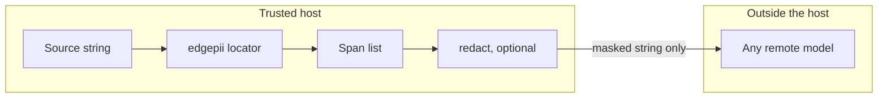

# First principles

<!-- ste: descriptive -->

A first principle here is a fact the team cannot remove without losing the job. Models, vendors, and card scores sit above these facts. When a design fights a fact, the design loses.

The chain that produces the facts is the [five whys](00-five-whys.md). The contract that encodes them is the [span contract](01-span-contract.md).

## Facts

| Id | Fact | Consequence |
| --- | --- | --- |
| F1 | The editable object is the source string | Public offsets are character indexes on that object |
| F2 | A document flag does not name characters | The library has no document-label API |
| F3 | The next action depends on the type | The public type comes from one taxonomy |
| F4 | A miss can leave the trust boundary | High-severity recall is a gate. Extra spans are a budget |
| F5 | Formats and genres move | A frozen regex set cannot be the only detector |
| F6 | A remote detect call is a copy | V1 loads weights on the host. See [ADR 0003](adr/0003-local-weights.md) |
| F7 | Card F1 is someone else's test | The golden set is the only ranker. See [evaluation](09-evaluation.md) |
| F8 | Token labels are not characters | Adapters convert BIO to offsets inside one module |
| F9 | Two people of one type are different | Placeholders use a counter per type per call |
| F10 | A password is not a stand-in | The locator finds secrets. `redact` then destroys them. See [ADR 0004](adr/0004-secrets-irreversible.md) |

F1 to F3 come from Chain B. F4 comes from the parent note on leak cost. A miss is a leak. An extra span is a utility cost. F6 follows because a remote detector would copy the source string before the mask.

## Axioms for the build

These axioms are the engineering form of the facts. They are short so a review can check a pull request against them.

1. Spans, not a document class.
2. Same source string. No silent normalize.
3. Taxonomy version on every result.
4. One span type in code. Detectors do not invent a second result shape.
5. Code scores spans. A language model does not judge exact-span F1.
6. Per-type metrics. No single PII bucket in the score report.
7. Rules and models both emit spans. The merger is the only place that resolves overlap.
8. The locator drops invalid offsets. It does not guess a repair.

## Kill list

| Kill for v1 | Fact it breaks |
| --- | --- |
| Regex-only hero detector | F5 |
| Chat model as the locator | F1, F7 |
| Whole-file delete as the privacy feature | F2's useful remainder. The file still has work |
| Copied leaderboard F1 as a go or no-go | F7 |
| Document classifier as the product | F2 |
| Cloud PII API as a default detector | F6 |
| Free-text types from the model | F3 |
| Fuzzy match to repair a bad offset | F1. The repair can bind the wrong copy |
| Logging `span.text` at INFO | The log becomes a second copy |

## Decisions that follow

| Decision | Choice | Record |
| --- | --- | --- |
| Public unit | Half-open character span | [ADR 0001](adr/0001-locate-spans.md) |
| Default models | One closed encoder, one open-schema model | [ADR 0002](adr/0002-two-default-lanes.md) |
| Where weights run | On the host in v1 | [ADR 0003](adr/0003-local-weights.md) |
| Secrets | Locate, then irreversible mask | [ADR 0004](adr/0004-secrets-irreversible.md) |
| When to leave the encoder | Only after the golden set shows a miss the encoder cannot close | [Research](04-research-landscape.md) |

## Trust boundary

Detection runs inside the trust boundary. A later product step can send text out only after it masks or drops the spans. `edgepii` does not open that socket.

The map from placeholder to original stays on the host. The library returns the map to the caller and does not store it. If restore fails, the caller shows the masked string. The library does not guess a person.

## Legal inputs, not detectors

Counsel uses these texts to decide which types exist. The library does not embed a legal conclusion.

| Input | Role | Link |
| --- | --- | --- |
| NIST SP 800-122 | US guide on PII confidentiality | [CSRC](https://csrc.nist.gov/pubs/sp/800/122/final) |
| GDPR Article 4 | EU definition of personal data | [EUR-Lex 2016/679](https://eur-lex.europa.eu/legal-content/EN/TXT/?uri=CELEX:32016R0679) |
| EDPB Guidelines 01/2025 | Pseudonymisation is not anonymisation when the map exists | [PDF](https://www.edpb.europa.eu/system/files/2025-01/edpb_guidelines_202501_pseudonymisation_en.pdf) |
| PDPO | Hong Kong ordinance. Counsel reads it. This spec does not interpret it | [PCPD](https://www.pcpd.org.hk/english/data_privacy_law/ordinance_at_a_Glance/ordinance.html) |

A placeholder plus a host-side map is pseudonymisation for the party that holds the map. It is still personal data for that party. The remote model does not receive the original if the mask is complete. Completeness is an eval result, not a slogan.

## Domain shift

A pattern that is true on synthetic email text can fail on a chat, an OCR line, or another language. F5 says the library must allow a new detector without a new result type. F7 says the team measures the new detector on a slice of the golden set before the team changes the default preset. The [AI engineering](03-ai-engineering.md) note states how that measurement works.
