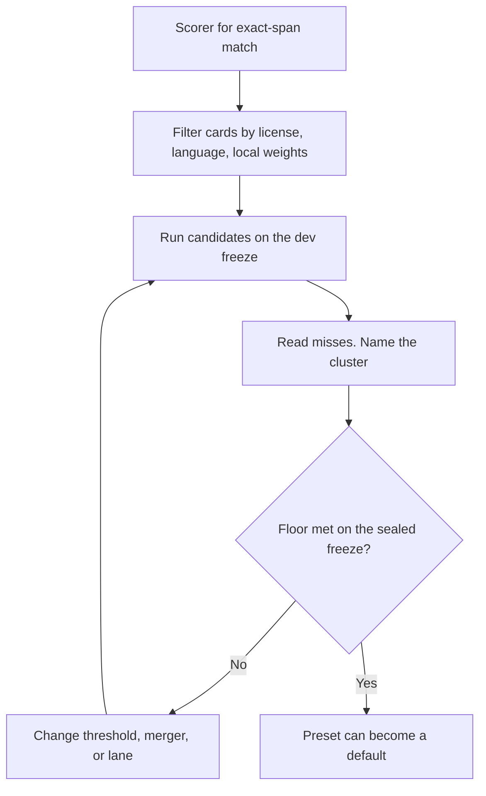

# AI engineering principles

<!-- ste: descriptive -->

This file applies current AI engineering practice to a closed task. Span location has a right answer a program can check. The team uses that fact. The team does not import habits that exist for open-ended chat.

Three public sources ground the practice below:

- Chip Huyen, *AI Engineering*. Evaluation criteria come before a build. Public benchmarks filter models. A private set picks the model. Cost and latency are criteria. Notes: [evaluation chapter summary](https://pagefy.io/ai-engineering/ai-engineering-by-chip-huyen/evaluate-ai-systems).
- Hamel Husain, [Your AI Product Needs Evals](https://hamel.dev/blog/posts/evals/index.html). Look at data. Write tests for failures you can show. Do not trust a generic score.
- Hamel Husain, [Evals FAQ](https://hamel.dev/blog/posts/evals-faq/). Do not invent a large eval for failures you did not observe. Exception: a constraint with a known success test. Exact span match is that exception.

## Principle 1. Write the scorer before the adapter

The success test is closed. A predicted span matches a gold span only when type, start, and end match. That test is exact-span F1. It is the same idea as exact entity match in the CoNLL-2003 shared task ([W03-0419](https://aclanthology.org/W03-0419/)).

Huyen calls this shape evaluation-driven development. Husain warns that the habit fails for open-ended chat, because the failures are not known yet. Both can be true here. The match rule is known, so the scorer comes first. The slices and the per-type floors come from misses the team reads, so those gates come second.

The first code in the [implementation plan](08-implementation-plan.md) is the scorer and a fake detector. No checkpoint is a default until that scorer runs.

## Principle 2. A private set outranks a card

Public numbers filter candidates. They do not crown a default. Huyen states that model selection is a private leaderboard. Hard filters come first: license, language, on-host weights, span output.

The [catalog](05-model-catalog.md) records card scores and paper scores as reported. Several of those numbers disagree with each other. The disagreement is a reason to ignore them as gates. The golden set is the ranker. See [evaluation](09-evaluation.md).

## Principle 3. Code judges spans. A model does not

Exact-span F1 is a deterministic compare. An LLM-as-judge adds a second model, a second prompt, and a score the team cannot replay bit for bit. That judge is forbidden for span F1.

A model can draft synthetic rows. A human freezes the golden set. The team never edits gold to chase a score.

## Principle 4. Look at misses, then add a slice

Husain's loop is: read traces, name the failure in plain language, cluster, write a narrow test for the costly cluster.

For this library the trace is one row: source string, gold spans, predicted spans. The plain failure is one of miss, wrong type, shift, or extra span. The team adds a slice when a cluster is real. Examples: OCR line breaks, code-mixed names, two people in one note, a secret next to a person name.

Do not add a slice for a failure the team did not observe. The Husain warning applies after the closed scorer exists.

## Principle 5. Score the part, then the whole

Huyen says to evaluate each component and the final output. The parts here are the rule detector, each model adapter, and the merger. The whole is the locator for one preset.

A gain in the merger can hide a regression in the encoder. The eval report shows both. The report never shows only a micro score over all types.

## Principle 6. Latency and license are filters, not a footnote

A model that misses the latency budget on CPU is out of the default preset, even if a paper F1 is higher. A license that blocks commercial use is out of the default preset. Piiranha is the example in the [catalog](05-model-catalog.md): the card carries a non-commercial term, so it is not a default.

Record p50 and p95 for locate on a fixed CPU note in the eval report. The team leaves the numeric budget open until it measures the target host.

## Principle 7. Smallest lane that meets the floor

The ladder in the [research note](04-research-landscape.md) is an escalation rule. Start with rules for checksums and a closed encoder for names. Move to an open-schema model when the type list must change at call time. Also move when the golden set shows a miss the encoder does not close. Move to a longer-context encoder when the window is the miss. Do not start at the heaviest model because a blog calls it best.

The closed lane is "BERT is enough" in engineering form. The 2026 encoder in the closed lane is ModernBERT, which keeps the token-classification contract and extends context. Classic BERT stays as the control. See [ADR 0002](adr/0002-two-default-lanes.md).

## Principle 8. Keep train and test apart

Synthetic text leaks when the same template sits in train and test. The split key is the template id, then the document id. The builder note and the locate note both require that split. The sealed test freeze is not a place to tune a threshold. Thresholds move on the dev freeze only.

## Principle 9. Tie the score to an action

A span score is not a product outcome. The outcome is the string a later step will send. Define leakage as the share of gold high-severity spans that remain in that string. Define utility as the task score on masked text.

The product that owns the task measures utility. `edgepii` reports the spans. The product owns the task score.

Huyen asks what the metric means for the business. A high-severity miss can block release of the mask path. The team leaves the numeric floor open.

The parent note sets a hard line: zero high-severity leakage on the freeze. That line is a product gate for the outbound string. The line does not claim that a model has zero misses. The second local pass and the rule lane exist because models miss. See [evaluation](09-evaluation.md).

## Loop

The loop does not include a step that copies a card F1 into the gate.

## What the team will not adopt

| Habit | Why it is out |
| --- | --- |
| LLM-as-judge for span match | Principle 3. The match is code |
| One demo screenshot as proof | Principle 4. Read a set, not one row |
| A new model as the default before the sealed freeze | Principle 2 |
| A generic NER score with no PII types | Principle 5. CoNLL types are not this taxonomy |
| Tuning on the sealed freeze | Principle 8 |
