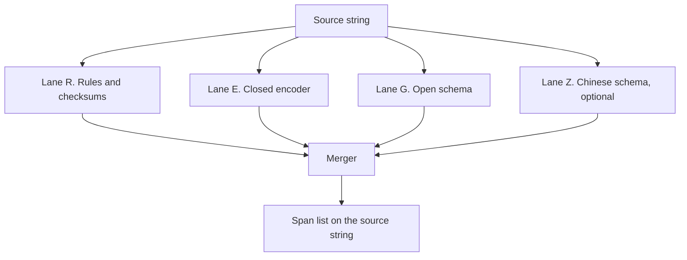

# Research landscape

The [5 November 2026 update](15-research-update-2026-11.md) supersedes this
snapshot for model selection and research versions. See its model manifest and
the [implementation plan](16-grounded-improvement-plan.md) before selecting a preset.

<!-- ste: descriptive -->

As of 4 November 2026. This file says which research lane fits the [span contract](01-span-contract.md). It does not rank models by a number we measured. This file marks paper figures and card figures as reported. They stay UNCONFIRMED as ship gates. See [AI engineering](03-ai-engineering.md) and [evaluation](09-evaluation.md).

The model rows and links live in the [catalog](05-model-catalog.md). This file is the map.

## The task in the literature

The public name is span NER, or token classification when the labels are BIO or BILOU. CoNLL-2003 fixed exact-entity match as the score ([W03-0419](https://aclanthology.org/W03-0419/)). SeqScore later set rules for fair sequence scores ([2021.eval4nlp-1.5](https://aclanthology.org/2021.eval4nlp-1.5/)).

CoNLL types are person, organization, location, and miscellaneous. Those types are not a PII taxonomy. A strong CoNLL model can still miss an email, a card, or a national id. The locate note records that limit. `dslim/bert-base-NER` is a CoNLL model, not a candidate default ([card](https://huggingface.co/dslim/bert-base-NER)).

## Lanes

| Lane | What it is | Contract fit | When it is the right tool |
| --- | --- | --- | --- |
| R | Patterns plus a validator | Yes when a standard defines the form | Email, phone, IBAN, card, IP, secret cue |
| E | Encoder with a token-classification head | Yes after offset mapping | Frozen types, known domain, low latency |
| G | Span model that takes the type list at call time | Yes. Native start and end | The taxonomy must move without a new train run |
| Z | Schema extractor for Chinese, ModelScope | Yes only if offsets check out | Chinese text and a host that loads ModelScope |
| Chat | A generative model that rewrites or emits JSON | Only if code checks offsets | Last. Not a v1 default |

Lane R is necessary and not sufficient. Names, messy addresses, and context-heavy ids need Lane E or Lane G.

## Lane E. Encoders

BERT showed that a bidirectional encoder can feed a token-classification head ([arXiv:1810.04805](https://arxiv.org/abs/1810.04805)). The head emits BIO or BILOU. The adapter turns those tags into character spans. That path meets the contract when labeled spans exist.

Later encoders keep the same head and change the backbone.

| Backbone | Why it exists | PII-shaped checkpoint |
| --- | --- | --- |
| BERT | Cheap control. Short context | [ab-ai/pii_model](https://huggingface.co/ab-ai/pii_model) |
| ClinicalBERT | Clinical notes | [obi/deid_bert_i2b2](https://huggingface.co/obi/deid_bert_i2b2), paper [arXiv:1904.03323](https://arxiv.org/abs/1904.03323) |
| RoBERTa | Stronger pretrain, same contract | [obi/deid_roberta_i2b2](https://huggingface.co/obi/deid_roberta_i2b2) |
| DeBERTa-v3 | Disentangled attention. Often paired with a CRF | [DataikuNLP/kiji-pii-model](https://huggingface.co/DataikuNLP/kiji-pii-model). DeBERTa v3: [arXiv:2111.09543](https://arxiv.org/abs/2111.09543) |
| ModernBERT | Long context, current encoder train | [antoniogr7/pii-identifier-v0.1](https://huggingface.co/antoniogr7/pii-identifier-v0.1). Paper [arXiv:2412.13663](https://arxiv.org/abs/2412.13663). Base weights [answerdotai/ModernBERT-base](https://huggingface.co/answerdotai/ModernBERT-base) |

Clinical de-identification is a neighbor task, not the default taxonomy. Stanford published a transformer de-identifier ([JAMIA, doi:10.1093/jamia/ocac219](https://doi.org/10.1093/jamia/ocac219), [card](https://huggingface.co/StanfordAIMI/stanford-deidentifier-base)). Use it only when the text is clinical and the data-use terms allow it. n2c2 text stays under its data-use agreement. Do not copy it into this repo.

## When the encoder is enough

Use a closed encoder when all of the lines below are true.

1. The team freezes the type list. Callers do not add a type at runtime.
2. The language and the genre match the train mix. For the ModernBERT candidate, that mix is English synthetic PII.
3. Labeled spans exist, or a public checkpoint already covers the types.
4. CPU cost and p95 latency matter more than a new type next week.
5. The context fits the window, or the window splitter in the [architecture](07-architecture.md) covers the tail.

Leave the encoder when any line below is true.

| Trigger | Next lane |
| --- | --- |
| The caller must pass a new type without a train run | Lane G |
| The golden set shows a residual miss on names after the caller floor moves | A stronger encoder, then Lane G |
| The document is longer than the encoder window and the splitter cuts gold spans | ModernBERT long context, or a wider overlap |
| The text is Chinese and the English encoder misses the slice | Lane Z, then measure |
| The text is clinical PHI under a research agreement | A de-id checkpoint, not the default preset |

BERT is a solution for the contract. BERT is not a claim of the best paper F1 on every set. The locate note says the same thing, and this spec keeps that caution. Soft-kill any "BERT" wrapper that has no offset path on the card.

The 2026 closed default is ModernBERT, not 2018 BERT-base. ModernBERT is still Lane E. It is the current form of "a BERT-family token classifier is enough". Preset `en-bert` keeps BERT-base as the control so the team can see what the extra backbone buys on the golden set.

## Lane G. Open schema

GLiNER matches label text to span vectors and returns start and end ([arXiv:2311.08526](https://arxiv.org/abs/2311.08526), [NAACL 2024](https://aclanthology.org/2024.naacl-long.300/)). The type list is an input. That property is why Lane G exists. A closed head cannot add `TAX_ID` on one call without a new label set and a new train run.

GLiNER2-PII adapts that idea to a PII inventory and a multilingual synthetic train set ([arXiv:2605.09973](https://arxiv.org/abs/2605.09973), 2026-05). The public weights are [fastino/gliner2-privacy-filter-PII-multi](https://huggingface.co/fastino/gliner2-privacy-filter-PII-multi). The card says 205M parameters. The paper abstract says about 0.3B. This spec does not resolve that gap. Read the card you pin.

Other span checkpoints in this lane: [nvidia/gliner-PII](https://huggingface.co/nvidia/gliner-PII), [urchade/gliner_multi_pii-v1](https://huggingface.co/urchade/gliner_multi_pii-v1), [gretelai/gretel-gliner-bi-large-v1.0](https://huggingface.co/gretelai/gretel-gliner-bi-large-v1.0), [knowledgator/gliner-pii-edge-v1.0](https://huggingface.co/knowledgator/gliner-pii-edge-v1.0).

LOGICAL studies local obfuscation with a GLiNER PII stack ([arXiv:2510.19346](https://arxiv.org/abs/2510.19346)). It is a system paper, not a default checkpoint.

## Reported scores, and why they are not the gate

SPY is a synthetic PII set with legal and medical subsets ([NAACL 2025 SRW](https://aclanthology.org/2025.naacl-srw.23/)). Authors score exact span match. Two write-ups of the same models do not match.

Paper table in [arXiv:2605.09973](https://arxiv.org/html/2605.09973), average exact-span F1: fastino 0.471, nvidia 0.391, urchade 0.384, OpenAI Privacy Filter 0.373, knowledgator base 0.368.

The fastino card table reports a different average: fastino 0.477, nvidia 0.400, urchade 0.398, OpenAI Privacy Filter 0.380 ([card](https://huggingface.co/fastino/gliner2-privacy-filter-PII-multi)).

A separate study of OpenAI Privacy Filter reports other SPY figures ([arXiv:2608.02616](https://arxiv.org/abs/2608.02616)). That paper also reports a training result. A fine-tuned encoder can pass a zero-shot filter after about 500 labeled rows, on that paper's protocol. The result supports Lane E when labels exist. Those figures are not our gate.

`antoniogr7/pii-identifier-v0.1` reports F1 0.9628 and F2 0.9699 on the Nemotron-PII test inside the PIIMB harness ([card](https://huggingface.co/antoniogr7/pii-identifier-v0.1)). That set is the train distribution's test split. It is not SPY. A high in-domain F1 does not imply a high SPY F1.

Do not average these tables. Do not pick a winner from them. Run the [golden set](09-evaluation.md).

## Lane Z. ModelScope and Chinese

Hugging Face is the default hub. ModelScope is the hub when the host is in a network that reaches ModelScope cleanly, or when the text is Chinese.

| Role | Id | Why it is here |
| --- | --- | --- |
| Schema spans for Chinese | [iic/nlp_structbert_siamese-uie_chinese-base](https://www.modelscope.cn/models/iic/nlp_structbert_siamese-uie_chinese-base) | The caller passes a schema. The lineage is UIE ([ACL 2022](https://aclanthology.org/2022.acl-long.395/), [arXiv:2203.12277](https://arxiv.org/abs/2203.12277)) on StructBERT ([arXiv:1908.04577](https://arxiv.org/abs/1908.04577)) |
| Same family, `damo` namespace | [damo/nlp_structbert_siamese-uie_chinese-base](https://www.modelscope.cn/models/damo/nlp_structbert_siamese-uie_chinese-base) | Alternate id seen in public tutorials. Pin one id in the adapter |
| PII token classifier mirror | [onnx-community/multilang-pii-ner-ONNX](https://www.modelscope.cn/models/onnx-community/multilang-pii-ner-ONNX) | ONNX mirror of an XLM-RoBERTa PII NER. Languages on the HF card: English, German, Italian, French ([HF card](https://huggingface.co/onnx-community/multilang-pii-ner-ONNX)) |

The ModelScope pages returned HTTP 500 from this writing environment on 4 November 2026. Search indexes still list the model ids. Re-check the card before you pin a hash.

Siamese-UIE is a general extractor. It is not a PII-tuned checkpoint. The adapter must prove `source[start:end]` equals the surface before a span is public. A Chinese generic NER such as RA-NER returns `{type, start, end, span}` ([modelscope issue 274](https://github.com/modelscope/modelscope/issues/274)) but the types are news types, not the taxonomy. Do not use it as a PII default.

## Lane R. Rules

Use rules for forms that a published grammar or checksum defines.

| Form | Check | Source |
| --- | --- | --- |
| Email | Local part 64 octets, path 254, dotted domain | [RFC 5321 section 4.5.3.1](https://www.rfc-editor.org/rfc/rfc5321#section-4.5.3.1) |
| Phone | Parse, then a validity or a possible-length test | [libphonenumber](https://github.com/google/libphonenumber), Python port |
| IBAN | Two letters, two check digits, MOD-97 | [ISO 13616](https://www.iso.org/standard/81090.html) |
| Payment card | 8 to 19 digits, a leading 1 to 9, Luhn | [ISO/IEC 7812-1](https://www.iso.org/standard/70484.html) |
| IP address | Text form, then a stdlib parse | [RFC 4291](https://www.rfc-editor.org/rfc/rfc4291), [RFC 3986](https://www.rfc-editor.org/rfc/rfc3986) |
| Secret | A cue word and one value token | [ADR 0004](adr/0004-secrets-irreversible.md). No standard exists, so the score stays null |
| National id | Only where policy names the pattern | Off unless the taxonomy type is enabled |

Every rule reports `1.0` only when a validator confirms the slice. A rule with no validator reports `null`. The library never invents a middle number, because a fixed value would order spans by nothing.

Microsoft Presidio already wires patterns and a transformers engine ([engine doc](https://microsoft.github.io/presidio/analyzer/nlp_engines/transformers/), [GitHub](https://github.com/microsoft/presidio)). Recognizers-Text covers several structured forms ([GitHub](https://github.com/microsoft/Recognizers-Text)). V1 does not depend on Presidio. A later bridge can convert our spans into Presidio results. One merger stays inside `edgepii`.

## Data the golden set can cite

| Set | Role | Link |
| --- | --- | --- |
| Nemotron-PII | Large synthetic English spans | [dataset](https://huggingface.co/datasets/nvidia/Nemotron-PII), [blog](https://huggingface.co/blog/nvidia/nemotron-pii) |
| OpenPII | Span and BIO fields, many rows | [1.5m](https://huggingface.co/datasets/ai4privacy/pii-masking-openpii-1.5m) |
| SPY | Out-of-domain legal and medical prose | [paper](https://aclanthology.org/2025.naacl-srw.23/) |
| Kiji train data | Multilingual synthetic, six languages | [DataikuNLP/kiji-pii-training-data](https://huggingface.co/datasets/DataikuNLP/kiji-pii-training-data) |

Synthetic rows need a template id. The sealed freeze must also hold a small human slice of the real channel. The locate note forbids a train-test bleed.

## Escalation ladder

Use this order. Skip a step only when the trigger in "when the encoder is enough" is already true on the dev freeze.

1. Lane R for structured types.
2. BERT-base control (`en-bert`) so the team has a cheap baseline.
3. ModernBERT closed preset (`en-closed`) for English and a frozen type list.
4. DeBERTa plus CRF only when the residual errors are illegal BIO paths the linear head emits. Kiji is the candidate, after a license re-read.
5. Lane G (`multi-open`, then `phi-open` if health types are in scope).
6. Lane Z for a Chinese slice.
7. A generative model only if it emits offsets and the scorer checks them. Not in v1.

## Systems that are adjacent

These systems mask and restore. They are consumers of spans, or rivals to the product around the library. They are not the locator contract.

| System | What it adds | Link |
| --- | --- | --- |
| Presidio anonymizer | Operators and an optional encrypt path | [docs](https://microsoft.github.io/presidio/anonymizer/) |
| Hide and Seek | Hide entities, then recover them in the answer | [arXiv:2309.03057](https://arxiv.org/abs/2309.03057) |
| Portcullis | A verifiable gateway paper | [doi:10.1609/aaai.v39i1.32088](https://doi.org/10.1609/aaai.v39i1.32088) |

Cloud detect APIs (Comprehend, Azure Language PII, Sensitive Data Protection) return spans and copy the text to the vendor. [ADR 0003](adr/0003-local-weights.md) keeps them out of v1.
