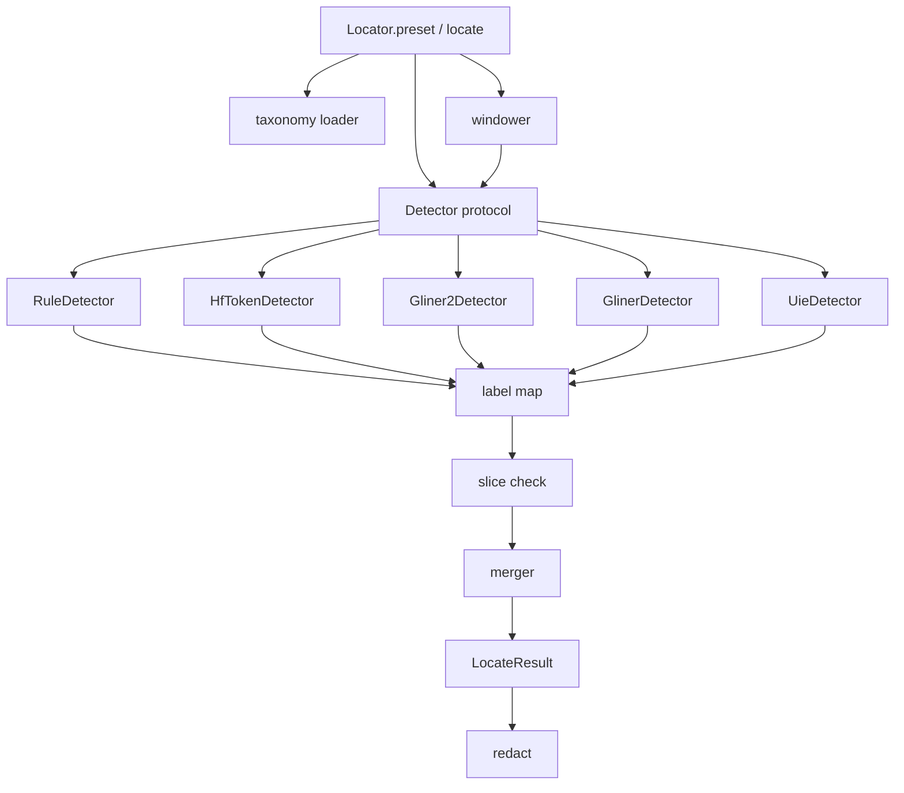
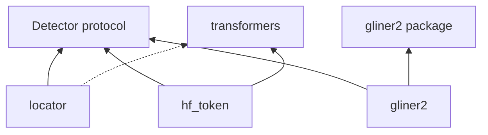
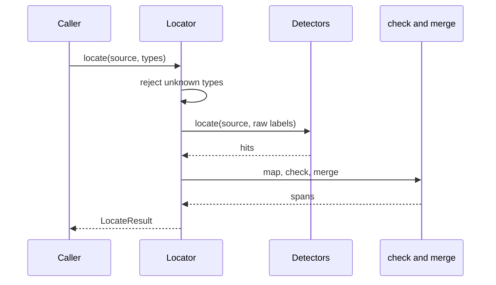

# Architecture

<!-- ste: descriptive -->

This file names the modules and the reason each module exists. The [implementation plan](08-implementation-plan.md) builds them in an order that keeps each module testable alone. The public surface is the [API](06-library-api.md).

## Module map



| Module | Owns | Does not own |
| --- | --- | --- |
| `span.py` | `Span`, `LocateResult` | Detection |
| `taxonomies/2026.11.yaml` | Types, ranks, maps | Python logic |
| `protocol.py` | `Detector` protocol | A framework base class with behavior |
| `locator.py` | Preset wiring, filter, call order | Overlap math |
| `windows.py` | Split and shift | Type policy |
| `labelmap.py` | Raw label to public type | Thresholds |
| `check.py` | Slice equality, drop counter | Merge |
| `merge.py` | One non-overlapping list | Model code |
| `redact.py` | Placeholder replace and vault return | Storage |
| `detectors/rules.py` | Email, phone, IBAN, Luhn, IP | Person names |
| `detectors/hf_token.py` | BERT and ModernBERT adapters | GLiNER |
| `detectors/gliner2.py` | fastino call | Taxonomy names as model labels |
| `detectors/gliner.py` | nvidia and urchade call | A second span type |
| `detectors/uie.py` | ModelScope schema call | English defaults |
| `eval/score.py` | Exact-span counts | Training |
| `presets.py` | Repo id, revision, extra | Downloaded weights |

## DRY

One fact lives in one place.

| Fact | Single home |
| --- | --- |
| Public fields of a span | `span.py` |
| Type list and label map | `2026.11.yaml` |
| Slice check | `check.py` |
| Overlap policy | `merge.py` |
| Placeholder syntax | `redact.py` |
| Window shift | `windows.py` |
| Hub repo id | `presets.py` |
| Exact-match count | `eval/score.py` |

An adapter that copies the slice check is a defect. An adapter that returns a dict the locator silently accepts is also a defect. The adapter returns `Span` or it returns a private `Hit` that `check.py` is the only module allowed to turn into a `Span`.

Preferred private type:

```python
@dataclass(frozen=True)
class Hit:
    raw_label: str
    start: int
    end: int
    score: float | None
    detector_id: str
```

`Hit` has no `text` and no public `type`. `check.py` reads `source[start:end]` and `labelmap.py` assigns the type. The adapter cannot disagree with the source string about the surface form.

## SOLID

**Single responsibility.** `RuleDetector` finds structured forms. `HfTokenDetector` runs one token-classification stack. `merge.py` only merges. `redact.py` only replaces. `Locator` only orders those steps. None of them parse YAML and call torch and score F1.

**Open for a new model.** A new checkpoint adds a preset row and, if the call shape is new, one detector class. `Locator.locate` does not grow a branch on the hub name. The protocol is the extension point.

**Substitution.** Every detector implements `locate(source, labels) -> tuple[Hit, ...]`. `labels` is the raw label list for the call, already limited by the caller subset. A test double returns hits. The slice check and the merger do not know which class produced them. Example 5 in the [examples](11-examples.md) depends on this.

**Small interface.** The protocol has `locate` and `max_chars`. It does not have `train`, `redact`, or `explain`. Batching is a loop in the locator until a detector offers `locate_many`. The locator uses `locate_many` only when the object has it. Missing `locate_many` is not an error.

**Dependency direction.** `locator.py` depends on the protocol, not on `transformers`, `gliner2`, or `modelscope`. Those imports live inside the detector modules. The core tests install no extra. Preset construction imports the detector module only when the caller requests that preset. A missing extra raises `DetectorLoadError` with the extra name.



The dotted edge breaks the rule. `locator` does not import `transformers`.

## Call sequence



Detectors in one preset run as a set. The rule detector always runs. Model detectors run when the preset names them. The merger sees the union. There is no hidden second pass inside a detector.

## Merge

<!-- ste: procedural -->

1. Drop a hit whose public type is outside the caller subset.
2. Drop a hit whose score is below `min_score`, when the caller passed one. A hit with no score also drops, because it has no measured confidence. With no `min_score` nothing drops on score. The slice check still applies.
3. Build overlap groups on half-open ranges.
4. In a group, keep the span with the higher class rank.
5. If the rank ties, keep the span whose type `prefer` matches the winning detector kind. `rule` prefers a `detector_id` that starts with `rules.`. `model` prefers any other id.
6. If that still ties, keep the longer span.
7. If length ties, keep the higher score.
8. If the score ties, keep the smaller start, then the name that sorts first, so the result is stable.

The steps live in `merge.py` only. Tests cover each tie with injected hits. No model weights.

## Windows

`max_chars` is a property of the detector. The adapter reads the checkpoint context at load time and sets the window from it. `HfTokenDetector` uses 75 percent of `max_position_embeddings` as a conservative character bound. The splitter exists because a caller can pass a longer string than the window.

<!-- ste: procedural -->

1. If `len(source) <= max_chars`, call the detector one time.
2. Else, cut on the last paragraph break that the overlap keeps behind the window start. If none exists, cut on the last space. If none exists, cut hard at `max_chars`.
3. Repeat the last `overlap_chars` characters at the start of the next window. Default `overlap_chars` is 64.
4. Add the window start to each hit offset before the slice check.
5. Let the merger drop duplicate ranges.

The cut has one requirement: the next window must start after the current one. A fixed "cut in the second half" rule has no source, so the splitter does not use it.

A gold span that the cut splits is a window bug. The eval slice `long_doc` in the [evaluation spec](09-evaluation.md) exists to catch it.

## Preset wiring

`presets.py` is data:

```python
Preset(
    name="en-closed",
    extra="hf",
    detectors=("rules", "hf_token"),
    repo_id="antoniogr7/pii-identifier-v0.1",
    revision="<pinned>",
)
```

`Locator.preset` reads that row. It does not special-case the name `en-closed` in `locate`.

## Logging and secrets

The logger is a parameter with a default that writes counts. Detectors receive a logger that already redacts. They do not format the source string into a message. Secret slices follow [ADR 0004](adr/0004-secrets-irreversible.md) inside `redact.py` only. The merger does not know the vault.

## Package layout

```text
src/edgepii/
  __init__.py
  span.py
  protocol.py
  locator.py
  windows.py
  labelmap.py
  check.py
  merge.py
  redact.py
  presets.py
  errors.py
  taxonomies/2026.11.yaml
  detectors/rules.py
  detectors/hf_token.py
  detectors/gliner2.py
  detectors/gliner.py
  detectors/uie.py
  eval/score.py
tests/
  test_contract.py
  test_merge.py
  test_redact.py
  test_rules.py
  test_windows.py
  test_score.py
```

`detectors/uie.py` lands in the optional phase. The tree does not import it from `__init__.py`.
