# Implementation plan

<!-- ste: descriptive -->

Build the library in the order below. Each phase has a test that fails before the phase and passes after it. Do not start a phase whose prior test is red. The design reasons are in the [architecture](07-architecture.md). The examples to satisfy are in [Examples](11-examples.md).

The order is the DRY and SOLID plan in execution form. Shared code lands before any model adapter. Adapters do not get a private span type. The scorer lands before any default model, as [AI engineering](03-ai-engineering.md) requires.

## Phase 0. Package skeleton

Create `src/edgepii` and `tests` with no detector. Export nothing that imports torch.

Acceptance: `python -c "import edgepii"` works in a virtualenv with no extras. The package declares the install extras in the [catalog](05-model-catalog.md) and does not import them yet.

## Phase 1. Contract types and the scorer

Write `Span`, `LocateResult`, and `eval/score.py`. Exact match means that the type, the start, and the end are the same. Report precision, recall, and F1 overall and per type. Also report miss, wrong type, shift, and extra span as counts. A shift is a gold span whose type matches an overlap that is not exact.

Acceptance: a hand-built gold list and a hand-built prediction list produce known counts. No model runs. This phase locks principle 1 in the AI engineering note.

## Phase 2. Taxonomy file

Add `taxonomies/2026.11.yaml` from the [taxonomy spec](10-taxonomy.md). The loader is the only reader. Unknown public types fail at load time in tests, and at call time for callers.

Acceptance: the loader returns the eleven types, the ranks, and the label map. A test feeds `email` and gets `EMAIL`. A test feeds `blood_type` and gets no public type.

## Phase 3. Slice check, merge, redact

Implement `check.py`, `merge.py`, and `redact.py` against injected hits. No weights.

Acceptance, all from the examples file:

- Example 4, the injected two-person redact.
- Example 5, a bad slice drops.
- Example 9, redact from the right.
- A unit test for each merge tie in the architecture note.
- A secret span becomes `<SECRET>` and stays out of the vault.

## Phase 4. Rule detector and the locator

Implement `RuleDetector`, `windows.py`, and `Locator.from_detectors`. Wire preset `rules`.

Acceptance:

- Example 1, email, phone, and the test PAN.
- Example 7, offsets after a long prefix.
- Example 8, empty string.
- `Order 48291` has no span.
- IBAN and a failed Luhn do not become `PAYMENT`. Use a known bad PAN in the test, such as `4242424242424243`.

Phone checks use the Python port of libphonenumber. Pin the package in this phase. One wrapper function is the only caller.

## Phase 5. Locator presets without weights

`Locator.preset("en-closed")` resolves the row and raises `DetectorLoadError` when the extra is absent. The error names the extra. It does not download.

Acceptance: on a clean env, preset `rules` works, and preset `en-closed` fails with `DetectorLoadError` before any network call.

## Phase 6. Closed encoder adapter

Implement `HfTokenDetector` as one class. Presets `en-bert` and `en-closed` both use it. The repo id comes from `presets.py`. BIO tags become hits through tokenizer offsets. The adapter returns `Hit`, not `Span`.

Acceptance:

- A tiny fixture string with an email yields a hit whose slice equals the email, even if the rule detector is disabled in that test.
- Window shift: set `max_chars` to 32. A long fake string must still yield offsets into the original source string.
- `locator.py` has no import of `transformers`. A test can read that file and assert the absence. Or block the module, then import the locator. Prefer an import-linter contract if the repo adds one.

Pin the revision in `presets.py` in this phase. Record the sha256 in the preset row.

## Phase 7. Dev freeze and the first real score

Build the dev freeze described in the [evaluation spec](09-evaluation.md). Run `rules`, `en-bert`, and `en-closed`. Write the report. Do not promote a default in the README of the package until the sealed freeze exists. The spec README can keep the candidate presets. The package docstring says "candidate" until phase 9.

Acceptance: the report shows per-type recall and a miss table. A human reads ten misses and files a one-line cluster for each. No threshold change happens in the same commit as the first report. Look first. Tune second. That split is principle 4.

## Phase 8. Open-schema adapter

Implement `Gliner2Detector` for `multi-open`. Pass only the raw labels for the caller subset.

Acceptance: example 3. A call with `types=["EMAIL"]` does not return `PERSON`. The label map drops unknown labels. Pin the revision.

Add `GlinerDetector` only if the dev freeze says health types are in scope. Otherwise leave `phi-open` unwired and say so in the phase note. Do not add the class "for completeness".

## Phase 9. Sealed freeze and preset promotion

Run the sealed freeze one time. Compare presets. Promote at most one closed preset and one open preset to "default candidate" in the package. Floors are the ones the eval spec states. If a floor still lacks a number, this phase sets the number from the dev freeze and writes it down before the sealed run. The sealed run does not change the number.

Acceptance: a short record in `docs/eval/` with the floors, the revisions, and the scores. The record does not contain raw source strings from a real channel. It can contain the fake examples.

## Phase 10. ModelScope adapter

Implement `UieDetector` behind extra `ms`. Schema names come from the taxonomy file, not from a second dict in the detector.

Acceptance: example 6 for phone and email on the rule lane, with UIE enabled. The person assertion stays model-dependent. If the live card's offset fails the slice check on a fixture, drop and count. Do not ship a search-based repair.

Skip this phase if no Chinese slice exists. The protocol does not change.

## Phase 11. Optional Presidio bridge

A function `to_presidio(spans)` converts spans to the Presidio dict shape for teams that already mask with Presidio. It lives in `edgepii/bridges/presidio.py`. The core package does not import Presidio.

Acceptance: one unit test with injected spans. No network.

## Work that stays out of every phase

| Work | Why it waits |
| --- | --- |
| Training a new head | The ladder says measure first. Training is a later project |
| A web service | The library runs in the caller program |
| Cloud detect adapters | [ADR 0003](adr/0003-local-weights.md) |
| Fuzzy restore | Parent note. Not a normal path |
| A document-level `contains_pii` API | Breaks the contract |
| Logging span text by default | Copies PII |

## Dependency rule during the build

A phase can use only modules from earlier phases. Phase 6 cannot teach `merge.py` about BIO. Phase 8 cannot add fastino labels outside the YAML. If a phase needs a new fact, add it to the single home named in the architecture note.

## Review checklist

<!-- ste: procedural -->

1. Confirm the change uses `Hit` until `check.py`.
2. Confirm a new model did not edit `merge.py`.
3. Confirm a new label edited the YAML only.
4. Confirm tests use the fake strings from the examples file.
5. Confirm the sealed freeze was not used to pick a threshold.
6. Confirm INFO logs in the diff do not format `source` or `span.text`.

## Suggested schedule shape

The phases are the schedule. Do not parallelize phase 6 and phase 8 across two public span types. Two people can split phase 6 (`en-bert` pin) and the rule tests only after phase 4 passes. The protocol is the shared contract that makes that split safe.

```mermaid
flowchart LR
  P0["0 skeleton"] --> P1["1 scorer"]
  P1 --> P2["2 taxonomy"]
  P2 --> P3["3 check merge redact"]
  P3 --> P4["4 rules"]
  P4 --> P5["5 preset errors"]
  P5 --> P6["6 encoder"]
  P6 --> P7["7 dev freeze"]
  P7 --> P8["8 open schema"]
  P8 --> P9["9 sealed freeze"]
  P9 --> P10["10 ModelScope"]
  P10 --> P11["11 Presidio bridge"]
```

Phase 10 and phase 11 can swap. Neither blocks phase 9.
