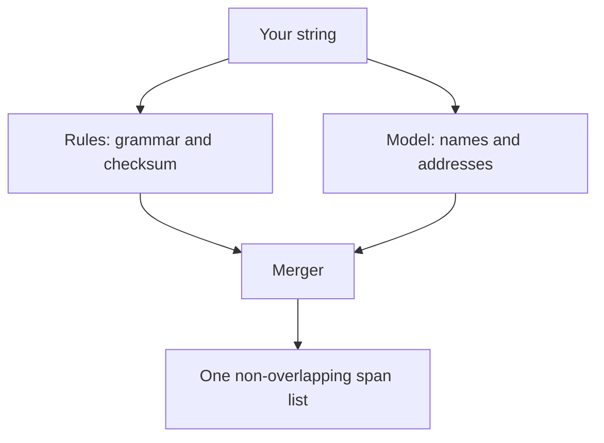

# How it works

<!-- ste: descriptive -->

Most PII tools answer one question: is this document sensitive? That answer is too coarse for a support ticket, a log line, or a prompt. The team still needs the rest of the string to do the work, and it needs proof of which characters left the system.

`edgepii` answers a narrower question, and the answer is checkable: **which characters, of which type, on this string?**

## The one rule

Every result row proves this:

```python
source[span.start:span.end] == span.text
```

That equation is the contract. If a detector returns an offset that fails it, the library drops the span and increments a counter. The library never searches your text for something that looks close.

Why so strict? Consider a span that is off by one character. `ada@example.com` becomes `da@example.com`. A mask built on that offset leaves the first character in place, and the address still resolves. A one-character bug is a data leak.

## Spans, not labels

| Approach | Result | Can you check it? |
| --- | --- | --- |
| Document classifier | One label per document | No. Which characters? |
| Chat model rewrite | New prose | No. What changed? |
| **Character spans** | **Typed ranges on your string** | **Yes, with one equality test** |

A span is a claim about a range. A claim about a range can be verified by a machine.

## Two lanes, one merge

The library combines two kinds of detector.



**Rules** own forms that a published standard defines. An email follows RFC 5321. A card follows ISO/IEC 7812-1 and a Luhn check. A phone follows libphonenumber. A rule reports a score of `1.0` only when a validator confirms the slice, and `None` when the form matched but no validator exists.

**Models** own forms that no grammar can express. A person name is the clearest case. There is no regex for "Ada Lovelace".

The merge matters. When two detectors disagree about overlapping characters, the library picks one winner by a fixed order: class rank, then the detector kind the type prefers, then the longer span, then the higher score, then the earlier start. The order never changes, so the same input gives the same output.

## Why a score of `None` is a fact

A `None` score means: a grammar matched and no validator exists. The library will not invent a number there, because a made-up `0.8` would order spans by nothing at all.

That choice moves a decision to you. The library ships **no** minimum score. If you want one, you measure it on your own data and pass `min_score`. A span with no score cannot meet a floor, so a floor removes it. The [taxonomy](../doc-taxonomy/) records this reasoning.

## The eleven types

| Type | Class | Who finds it | Example |
| --- | --- | --- | --- |
| `SECRET` | secret | rule | `password: hunter2` |
| `GOV_ID` | gov_id | rule | A national id, where policy names the pattern |
| `PAYMENT` | payment | rule | A card after Luhn, an IBAN after MOD-97 |
| `EMAIL` | contact | rule | `ada@example.com` |
| `PHONE` | contact | rule | `+852 5555 0101` |
| `IP_ADDRESS` | contact | rule | `198.51.100.7` |
| `USERNAME` | contact | model | A login name |
| `PERSON` | person | model | `Ada Lovelace` |
| `ADDRESS` | person | model | `12 Rue de Rivoli` |
| `DATE_OF_BIRTH` | quasi | model | Off by default |
| `ORG` | quasi | model | Off by default |

Eleven types is a deliberate limit. A finer list is a new taxonomy version, not a fork inside one adapter. The [taxonomy page](../doc-taxonomy/) shows how a model label such as `credit_debit_card` folds into the public type `PAYMENT`.

## Rank breaks a tie

Each class has a rank. A secret outranks a government id, which outranks a payment, which outranks a contact.

This is why a card number that also looks like a national id resolves to one answer instead of two. The rank is data in one YAML file, not a condition buried in code.

## Masking is reversible, except for secrets

`redact` walks the span list from the right, so earlier offsets stay valid. Each span becomes `<TYPE_N>`, and the vault maps that placeholder back to the original slice.

A `SECRET` is the exception. It becomes `<SECRET>` and never enters the vault. A restore would write a password into a ticket, a log, or a second prompt. That decision is recorded as [ADR 0004](../doc-index/).

## What it does not do

- It does not decide that a document is sensitive. Use a classifier for that.
- It does not rewrite your prose. You keep the text; only spans are replaced.
- It does not send your string to a cloud PII service. All weights are local.
- It does not find a name on the rule lane. That is a model job.

## Next

- See it run in the [live demo](../demo/)
- Read [fifteen worked examples](../guide-examples/) with real output
- Check the [accuracy claim](../evaluation/) on public data
